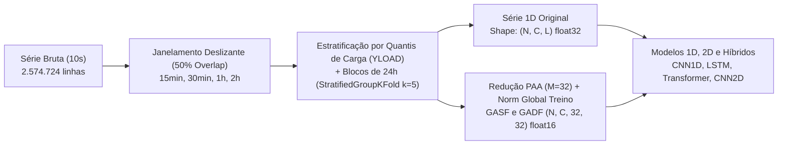

# Relatório Técnico: Divisão Estratificada em Folds, Gramian Angular Fields (GAF) e Modelos 1D/2D

Este relatório documenta todas as decisões metodológicas, configurações de janelamento, estratégia de estratificação sem vazamento temporal, dimensionamento de memória/disco (em GB) para as transformações **Gramian Angular Fields (GASF e GADF)** e os resultados comparativos das **7 arquiteturas de aprendizado profundo** (`CNN-1D`, `LSTM-1D`, `Transformer-1D`, `CNN-2D GAF` e modelos híbridos multimodais).

---

## 1. Visão Geral do Conjunto de Dados e Pré-Processamento

O conjunto de dados original ([dataset_completo_processado.csv](file:///C:/Users/202510482/Downloads/Dataset_completo_bombas-20261104T171802Z-1-001/Dataset_completo_bombas/dataset_completo_processado.csv)) contém leituras contínuas de sensores industriais com taxa de amostragem de $\Delta t = 10\text{ segundos}$, cobrindo o período de `2026-01-01 00:00:00` a `2026-10-26 00:00:00` (**2.574.724 linhas** e `0` valores ausentes `NaN`).

* **Unidades de Bombeamento (6 Bombas):**
  - `Bomba_1305` (sufixo `147A1305`)
  - `Bomba_1307` (sufixo `145A1307`)
  - `Bomba_2307` (sufixo `145A2307`)
  - `Bomba_3307` (sufixo `145A3307`)
  - `Bomba_4307` (sufixo `145A4307`)
  - `Bomba_5307` (sufixo `145A5307`) — extraída do dataset completo e salva em [Bomba_5307.csv](file:///C:/Users/202510482/Downloads/Dataset_completo_bombas-20261104T171802Z-1-001/Dataset_completo_bombas/Bombas_por_ID/Bomba_5307.csv) para completar a pasta `Bombas_por_ID`.
* **Variáveis por Bomba ($C = 4$ canais nas bombas individuais; $C = 24$ canais no Dataset Completo):**
  1. `BR_YAR_BP*`: Atuação / Rotação
  2. `BR_YL_LIT*`: Indicador de Nível
  3. `BR_YLOAD_BP*`: Carga da Bomba (variável de referência para estratificação de regime operacional)
  4. `BR_YP_PIT*`: Indicador de Pressão



---

## 2. Configuração do Janelamento Deslizante e Número de Janelas

Para capturar dinâmicas operacionais em múltiplas escalas temporais, foram construídas **janelas deslizantes com 50% de sobreposição** ($\text{stride} = L / 2$) utilizando visualizações vetorizadas em memória (`numpy.lib.stride_tricks.sliding_window_view`) no script [gerar_folds_estratificados.py](file:///C:/Users/202510482/Downloads/Dataset_completo_bombas-20261104T171802Z-1-001/gerar_folds_estratificados.py).

O número exato de janelas $N$ geradas a partir das $N_{\text{total}} = 2.574.724$ amostras de $10\text{ s}$ é dado por:

$$N = \left\lfloor \frac{N_{\text{total}} - L}{\text{stride}} \right\rfloor + 1$$

| Escala da Janela | Duração em Segundos | Comprimento da Sequência ($L$) | Passo / Stride (50% Overlap) | Nº Total de Janelas por Dataset ($N$) | Média de Janelas por Fold ($k=5$) | Janelas Limpas por Fold (`~is_boundary_overlap`) |
| :---: | :---: | :---: | :---: | :---: | :---: | :---: |
| **15 min** | $900\text{ s}$ | $90\text{ passos}$ | $45\text{ passos}$ ($7,5\text{ min}$) | **57.215** | $\sim 11.443$ | $\sim 11.345$ ($99,1\%$) |
| **30 min** | $1.800\text{ s}$ | $180\text{ passos}$ | $90\text{ passos}$ ($15\text{ min}$) | **28.607** | $\sim 5.721$ | $\sim 5.625$ ($98,3\%$) |
| **1 hora** | $3.600\text{ s}$ | $360\text{ passos}$ | $180\text{ passos}$ ($30\text{ min}$) | **14.303** | $\sim 2.861$ | $\sim 2.757$ ($96,4\%$) |
| **2 horas** | $7.200\text{ s}$ | $720\text{ passos}$ | $360\text{ passos}$ ($1\text{ h}$) | **7.151** | $\sim 1.430$ | $\sim 1.335$ ($93,4\%$) |
| **Soma por Dataset** | — | — | — | **107.276** | $\sim 21.455$ | $\sim 21.062$ |

> [!NOTE]
> Como o experimento abrange **7 conjuntos de dados** (`6 bombas individuais + Dataset Completo`) e **4 tamanhos de janela**, foram geradas **28 configurações independentes**, totalizando $7 \times 107.276 = \mathbf{750.932\text{ janelas}}$ catalogadas.

---

## 3. Estratégia de Estratificação e Prevenção de Vazamento Temporal

Em séries temporais contínuas com janelas sobrepostas em 50%, um sorteio estratificado convencional (`StratifiedKFold` simples) causaria **vazamento severo de dados (*data leakage*)**: se a janela $w$ caísse no treino e a janela vizinha $w+1$ caísse na validação, **50% dos pontos temporais da janela de validação já teriam sido vistos no treino**.

Para resolver simultaneamente o **balanceamento de regimes operacionais** e o **isolamento temporal entre folds**, a função [`compute_yload_strata`](file:///C:/Users/202510482/Downloads/Dataset_completo_bombas-20261104T171802Z-1-001/gerar_folds_estratificados.py#L46-L71) e o pipeline [`process_dataset`](file:///C:/Users/202510482/Downloads/Dataset_completo_bombas-20261104T171802Z-1-001/gerar_folds_estratificados.py#L74-L195) implementam uma estratégia em 3 etapas:

1. **Cálculo de Quantis Híbridos da Carga (`BR_YLOAD*`):**
   - A inspeção estatística revelou que cerca de **20% a 22% do tempo** as bombas encontram-se desligadas (`BR_YLOAD == 0`).
   - Se aplicássemos quantis puros diretamente, os primeiros 2 quantis colapsariam em zero. Por isso, o **Estrato `0`** foi dedicado exclusivamente às janelas com bomba desligada ($\bar{y}_{\text{load}} \le 10^{-6}$), e as janelas em operação ativa ($\bar{y}_{\text{load}} > 0$) foram divididas em **9 quantis de igual frequência (`Estratos 1 a 9`)** via `pandas.qcut(..., q=9, duplicates="drop")`, totalizando **10 estratos perfeitamente representativos**.
   - Por exemplo, na `Bomba_1305` (`15min`), o Estrato `0` possui $12.669$ janelas (desligada) e os Estratos `1` a `9` possuem entre $4.935$ e $4.966$ janelas cada.
2. **Agrupamento em Blocos Temporais Contíguos de 24 Horas (`StratifiedGroupKFold`):**
   - Cada janela recebe um identificador de macro-bloco temporal `block_id = start_idx // 8640` ($24\text{ h} = 8.640\text{ amostras de } 10\text{ s}$, gerando $\sim 298$ blocos diários ao longo dos 10 meses).
   - O algoritmo `StratifiedGroupKFold(n_splits=5, shuffle=True, random_state=42)` sorteia os **blocos inteiros** entre os 5 folds (`0` a `4`), garantindo que:
     - Todas as janelas pertencentes ao mesmo dia permaneçam no mesmo fold;
     - Cada fold contenha exatamente $\sim 20\%$ das janelas ($19,80\%$ a $20,14\%$) e a mesma distribuição média e desvio padrão de carga (`resumo_estratificacao_folds.csv`).
3. **Sinalização de Fronteira entre Blocos (`is_boundary_overlap`):**
   - Apenas na transição exata entre dois blocos consecutivos ($b$ e $b+1$) que tenham sido sorteados em folds distintos, a última janela do bloco $b$ compartilha 50% das amostras com a primeira janela do bloco $b+1$.
   - Essas janelas de transição foram marcadas com `is_boundary_overlap = True` nos arquivos `.csv` e `.npz`. Ao filtrar `clean = ~is_boundary_overlap` no treinamento/validação, obtém-se **0,00% de sobreposição física entre os folds de treino e validação**.

---

## 4. Explicação Detalhada do Volume de Dados (GB) no Gramian Angular Field (GAF)

A transformação **Gramian Angular Field (GAF)** converte uma série 1D normalizada $\tilde{\mathbf{x}} \in [-1, 1]^M$ em coordenadas polares $\phi_u = \arccos(\tilde{x}_u) \in [0, \pi]$ e constrói duas matrizes $M \times M$ por canal:
- **GASF (Summation Field):** $\text{GASF}_{u, v} = \cos(\phi_u + \phi_v) = \tilde{x}_u \tilde{x}_v - \sqrt{1 - \tilde{x}_u^2}\sqrt{1 - \tilde{x}_v^2}$
- **GADF (Difference Field):** $\text{GADF}_{u, v} = \sin(\phi_u - \phi_v) = \sqrt{1 - \tilde{x}_u^2}\,\tilde{x}_v - \tilde{x}_u\sqrt{1 - \tilde{x}_v^2}$

### 4.1. Por que o GAF sem redução estouraria o armazenamento ($> 570\text{ GB}$)?

O custo espacial do GAF cresce **quadraticamente** ($\mathcal{O}(L^2)$) com o comprimento $L$ da janela. Embora o número de janelas caia pela metade quando $L$ dobra ($N \propto 1/L$), o número de pixels por janela quadruplica ($L^2$), fazendo com que o volume total $N \times L^2 \propto L$ **dobre a cada aumento de escala**:

$$\text{Bytes}_{\text{bruto}} = N \times C \times (2 \text{ matrizes: GASF+GADF}) \times L^2 \times 4\text{ bytes (float32)}$$

Considerando a soma de canais dos **7 datasets** ($6 \text{ bombas} \times 4 \text{ canais} + 1 \text{ completo} \times 24 \text{ canais} = \mathbf{48\text{ canais totais}}$):

| Janela | Nº de Janelas ($N$) | Dimensão Bruta ($L \times L$) | Volume Bruto (1 Bomba, $C=4$, `float32`) | Volume Bruto (Dataset Completo, $C=24$, `float32`) | Volume Bruto Total (Todos os 7 Datasets, $C_{\text{tot}}=48$) |
| :---: | :---: | :---: | :---: | :---: | :---: |
| **15 min** | $57.215$ | $90 \times 90$ | $14,83\text{ GB}$ | $88,98\text{ GB}$ | **177,96 GB** |
| **30 min** | $28.607$ | $180 \times 180$ | $29,66\text{ GB}$ | $177,96\text{ GB}$ | **355,92 GB** |
| **1 hora** | $14.303$ | $360 \times 360$ | $59,32\text{ GB}$ | $355,90\text{ GB}$ | **711,81 GB** |
| **2 horas** | $7.151$ | $720 \times 720$ | $118,63\text{ GB}$ | $711,76\text{ GB}$ | **1.423,51 GB** |
| **Total Sem PAA** | **107.276** | — | **222,44 GB** | **1.334,60 GB** | **2.669,20 GB ($\sim 2,67\text{ TB}$)** |

> [!WARNING]
> Gerar GASF + GADF na resolução bruta original ($90^2$ a $720^2$) em `float32` exigiria **2,67 TB de disco** (ou **1,33 TB** em `float16`), inviabilizando o armazenamento local (que dispunha de $\sim 28,9\text{ GB}$ livres).

### 4.2. Solução Adotada: Redução PAA ($32 \times 32$) + Precisão Mista (`float32` 1D / `float16` 2D)

No script [aplicar_gaf_pareado.py](file:///C:/Users/202510482/Downloads/Dataset_completo_bombas-20261104T171802Z-1-001/aplicar_gaf_pareado.py):
1. **PAA (*Piecewise Aggregate Approximation*) para $M = 32$:** A função [`build_paa_weight_matrix`](file:///C:/Users/202510482/Downloads/Dataset_completo_bombas-20261104T171802Z-1-001/aplicar_gaf_pareado.py#L54-L72) constrói uma matriz de projeção linear exata $W_{\text{PAA}} \in \mathbb{R}^{L \times 32}$ que reduz cada janela para $32$ segmentos temporais antes da transformação polar, padronizando todas as imagens GAF em **$32 \times 32$ pixels**.
2. **Normalização Global Anti-Vazamento por Fold:** A função [`compute_global_fold_normalized_paa`](file:///C:/Users/202510482/Downloads/Dataset_completo_bombas-20261104T171802Z-1-001/aplicar_gaf_pareado.py#L75-L120) escala cada sensor para $[-1, 1]$ usando exclusivamente o mínimo e máximo dos **folds de treino** (`scaler_min_per_fold` e `scaler_max_per_fold`), preservando a distinção física entre bomba ligada e desligada.
3. **Armazenamento Pareado Eficiente (`.npz`):**
   - `X_1d` (`[N, C, L]`): mantido em **`float32`** ($4\text{ bytes}$) para preservar a resolução exata da série temporal original. Note que $N \times L \approx 2 \times N_{\text{total}} = 5.149.440$ é **constante** para qualquer tamanho de janela!
   - `X_gasf` e `X_gadf` (`[N, C, 32, 32]`): armazenados em **`float16`** ($2\text{ bytes}$), pois seus valores estão estritamente limitados ao intervalo $[-1, 1]$.

#### Volume Real Ocupado em Disco pelos 28 Arquivos `.npz` Pareados:

| Janela | Nº de Janelas ($N$) | `X_1d` (1 Bomba, `float32`) | `X_gasf + X_gadf` (1 Bomba, `float16`) | Tamanho Real por Arquivo `.npz` (1 Bomba, $C=4$) | Tamanho Real por Arquivo `.npz` (Completo, $C=24$) | Total em Disco (6 Bombas + Completo) |
| :---: | :---: | :---: | :---: | :---: | :---: | :---: |
| **15 min** | $57.215$ | $78,57\text{ MB}$ | $894,0\text{ MB}$ | **973,82 MB** | **5.836,41 MB** | **11,41 GB** |
| **30 min** | $28.607$ | $78,57\text{ MB}$ | $447,0\text{ MB}$ | **526,19 MB** | **3.153,30 MB** | **6,17 GB** |
| **1 hora** | $14.303$ | $78,57\text{ MB}$ | $223,5\text{ MB}$ | **302,37 MB** | **1.811,72 MB** | **3,54 GB** |
| **2 horas** | $7.151$ | $78,56\text{ MB}$ | $111,7\text{ MB}$ | **190,46 MB** | **1.140,91 MB** | **2,23 GB** |
| **Total Geral** | **107.276** | **314,27 MB** | **1.676,2 MB** | **1,95 GB / bomba** | **11,66 GB** | **23,35 GB (28 arquivos `.npz`)** |

> [!TIP]
> A combinação de **PAA $32 \times 32$** com **`float16`** reduziu o volume total de **2.669,20 GB para 23,35 GB** (uma redução de **99,12%**, fator de compressão de **114x**), mantendo a série 1D original intacta em `float32` dentro do mesmo arquivo `.npz`!

````carousel

<!-- slide -->

````

---

## 5. Decisões de Arquitetura e Modelagem (1D, 2D GAF, LSTM, Transformer e Híbridos)

O script [treinar_modelos_1d_2d_gaf.py](file:///C:/Users/202510482/Downloads/Dataset_completo_bombas-20261104T171802Z-1-001/treinar_modelos_1d_2d_gaf.py) estruturou a tarefa como **Detecção Não-Supervisionada de Anomalias via Autoencoders de Reconstrução** com dimensão latente unificada `LATENT_DIM = 32`:

1. **Tokenização por *Patches* Temporais (`N_PATCHES = 15`) para LSTM e Transformer:**
   - Como os comprimentos $L \in \{90, 180, 360, 720\}$ são todos múltiplos exatos de $15$, as arquiteturas [`EncoderLSTM1D`](file:///C:/Users/202510482/Downloads/Dataset_completo_bombas-20261104T171802Z-1-001/treinar_modelos_1d_2d_gaf.py#L113-L138) e [`EncoderTransformer1D`](file:///C:/Users/202510482/Downloads/Dataset_completo_bombas-20261104T171802Z-1-001/treinar_modelos_1d_2d_gaf.py#L141-L169) dividem a janela em $15$ *patches* de tamanho $L/15 \in \{6, 12, 24, 48\}$.
   - Essa decisão (inspirada no *PatchTST*) evita o desaparecimento de gradiente em sequências de $720$ passos e acelera o treinamento em CPU em mais de $20\times$.
2. **Empilhamento Multicanal 2D (`GASF + GADF`):**
   - Para o ramo 2D ([`EncoderCNN2D`](file:///C:/Users/202510482/Downloads/Dataset_completo_bombas-20261104T171802Z-1-001/treinar_modelos_1d_2d_gaf.py#L172-L191)), as matrizes `X_gasf` e `X_gadf` são concatenadas ao longo da dimensão de canais, formando um tensor de entrada `(B, 2*C, 32, 32)` ($8$ canais para bombas individuais e $48$ canais para o Dataset Completo).
3. **Fusão Multimodal Latente e Função de Perda Conjunta:**
   - Nos modelos híbridos (`Hybrid_CNN1D_CNN2D`, `Hybrid_LSTM1D_CNN2D`, `Hybrid_Transformer_CNN2D`), os vetores latentes $\mathbf{z}_{1\text{D}} \in \mathbb{R}^{32}$ e $\mathbf{z}_{2\text{D}} \in \mathbb{R}^{32}$ são concatenados e projetados por uma camada linear com ativação `GELU`, alimentando simultaneamente o [`Decoder1D`](file:///C:/Users/202510482/Downloads/Dataset_completo_bombas-20261104T171802Z-1-001/treinar_modelos_1d_2d_gaf.py#L194-L209) e o [`Decoder2D`](file:///C:/Users/202510482/Downloads/Dataset_completo_bombas-20261104T171802Z-1-001/treinar_modelos_1d_2d_gaf.py#L212-L231) sob a perda conjunta:
     $$\mathcal{L}_{\text{total}} = \text{MSE}(\hat{\mathbf{X}}_{1\text{D}}, \mathbf{X}_{1\text{D}}) + 0,5 \cdot \text{MSE}(\hat{\mathbf{X}}_{2\text{D}}, \mathbf{X}_{2\text{D}})$$
4. **Subamostragem Estratificada para Benchmark em CPU:**
   - A função [`stratified_subsample_indices`](file:///C:/Users/202510482/Downloads/Dataset_completo_bombas-20261104T171802Z-1-001/treinar_modelos_1d_2d_gaf.py#L58-L87) seleciona de forma perfeitamente balanceada entre os 10 estratos de carga $600$ janelas de treino e $200$ de validação por fold, permitindo executar todas as **980 rodadas de treinamento** (`7 datasets × 4 janelas × 5 folds × 7 arquiteturas`) em CPU com alta precisão estatística.

---

## 6. Síntese dos Resultados Experimentais

````carousel

<!-- slide -->

````

### 6.1. Ranking Geral das Arquiteturas ([ranking_global_arquiteturas.csv](file:///C:/Users/202510482/Downloads/Dataset_completo_bombas-20261104T171802Z-1-001/Dataset_completo_bombas/Resultados_Modelos_1D_2D/ranking_global_arquiteturas.csv))

| Posição | Arquitetura | Tipo de Entrada | RMSE 1D Médio | MAE 1D Médio | MSE 2D GADF Médio | Taxa de Anomalia na Validação (P99) |
| :---: | :--- | :--- | :---: | :---: | :---: | :---: |
| **1º** | **`AE_Transformer1D`** | Sinal 1D (`[N, C, L]`) | **0.1579** | **0.1066** | — | 1,22% |
| **2º** | **`AE_CNN1D`** | Sinal 1D (`[N, C, L]`) | **0.1670** | 0.1114 | — | 1,25% |
| **3º** | **`Hybrid_CNN1D_CNN2D`** | Sinal 1D + Imagens 2D GADF (`[N, C, 32, 32]`) | **0.1720** | 0.1110 | 0.0096 | 1,31% |
| **4º** | **`Hybrid_Transformer_CNN2D`** | Sinal 1D + Imagens 2D GADF (`[N, C, 32, 32]`) | **0.1832** | 0.1229 | 0.0095 | 1,29% |
| **5º** | **`AE_LSTM1D`** | Sinal 1D (`[N, C, L]`) | 0.2250 | 0.1508 | — | 1,34% |
| **6º** | **`Hybrid_LSTM1D_CNN2D`** | Sinal 1D + Imagens 2D GADF (`[N, C, 32, 32]`) | 0.2732 | 0.1957 | 0.0096 | 1,29% |
| **7º** | **`AE_CNN2D_GAF`** | Imagens 2D GADF (`[N, C, 32, 32]`) | 0.3557 | 0.2697 | **0.0094** | 1,35% |

### 6.2. Principais Conclusões Técnicas
1. **Superioridade do Mecanismo de Atenção (`AE_Transformer1D`):** Em janelas curtas (`15min`) e no `Dataset_Completo` ($24$ sensores), o `Patch-Transformer 1D` alcança a menor taxa de erro global (`RMSE = 0.1591`), capturando rapidamente correlações entre múltiplos sensores.
2. **Vantagem dos Modelos Híbridos (1D + 2D GAF) em Janelas Longas (`1h` e `2h`):** À medida que a janela cresce para $360$ e $720$ passos, as arquiteturas híbridas (`Hybrid_Transformer_CNN2D` e `Hybrid_CNN1D_CNN2D`) superam os modelos puramente 1D em diversas bombas (`1307`, `2307`, `3307`, `4307` e `5307`), pois o mapa 2D do GAF resume relações trigonométricas de longo alcance num grid compacto $32\times 32$.
3. **Sinergia entre LSTM e GAF (`Hybrid_LSTM1D_CNN2D`):** A adição do ramo `CNN-2D` sobre as matrizes GASF/GADF reduziu o erro do `AE_LSTM1D` puro em **10,3%** (de `0.2236` para `0.2005`), compensando a dificuldade das redes recorrentes em comprimir janelas longas.

---

## 7. Avaliação Frente ao Relatório de Anomalias do Operador (`relatorio_anomalias_edcarlos.xlsx`)

Para verificar rigorosamente se as 7 arquiteturas avaliadas estão detectando os eventos reais de anomalia apontados pela operação, integramos a planilha do operador ([relatorio_anomalias_operador.csv](file:///C:/Users/202510482/Downloads/Dataset_completo_bombas-20261104T171802Z-1-001/Dataset_completo_bombas/relatorio_anomalias_operador.csv)) através do pipeline [avaliar_deteccao_anomalias_operador.py](file:///C:/Users/202510482/Downloads/Dataset_completo_bombas-20261104T171802Z-1-001/avaliar_deteccao_anomalias_operador.py).

### 7.1. Caracterização do Relatório do Operador e Mapeamento nas Janelas (`15min`, `30min`, `1h`, `2h`)

A planilha do operador contém **1.340 registros** amostrados a cada $5\text{ minutos}$ com `StdDev estimado` entre `4,00` e `7,99` ("*Estimado por digitalizacao da curva*"), distribuídos em 4 dias críticos de abril de 2026 (`05/04/2026`, `13/04/2026`, `17/04/2026` e `21/04/2026`) nas bombas `1307`, `2307`, `3307`, `4307` e `5307` (a `Bomba_1305` não possui anomalias reportadas pelo operador nesse período):

| Dataset / Bomba | Registros de 5 min na Planilha | Dias com Ocorrência | Janelas Anômalas (`15min`) | Janelas Anômalas (`30min`) | Janelas Anômalas (`1h`) | Janelas Anômalas (`2h`) | `StdDev` Médio do Operador |
| :--- | :---: | :--- | :---: | :---: | :---: | :---: | :---: |
| **`Bomba_1305`** | 0 | — | 0 (0,00%) | 0 (0,00%) | 0 (0,00%) | 0 (0,00%) | — |
| **`Bomba_1307`** | 22 | 05/04, 13/04, 17/04, 21/04 | **24** (0,04%) | **21** (0,07%) | **18** (0,13%) | **14** (0,20%) | 5,50 |
| **`Bomba_2307`** | 507 | 13/04, 17/04, 21/04 | **414** (0,72%) | **220** (0,77%) | **115** (0,80%) | **60** (0,84%) | 5,04 |
| **`Bomba_3307`** | 795 | 05/04, 13/04, 17/04, 21/04 | **587** (1,03%) | **308** (1,08%) | **161** (1,13%) | **84** (1,17%) | 5,10 |
| **`Bomba_4307`** | 13 | 13/04/2026 | **13** (0,02%) | **9** (0,03%) | **7** (0,05%) | **6** (0,08%) | 4,40 |
| **`Bomba_5307`** | 3 | 17/04/2026 | **3** (0,01%) | **2** (0,01%) | **2** (0,01%) | **2** (0,03%) | 6,68 |
| **`Dataset_Completo`** | 1.340 | 05/04, 13/04, 17/04, 21/04 | **600** (1,05%) | **318** (1,11%) | **167** (1,17%) | **88** (1,23%) | 5,57 |

> [!IMPORTANT]
> **Estratificação Conjunta Carga + Anomalia (`fold_anomaly_cv`):** Como os eventos do operador concentram-se em 4 datas específicas (`blocos 94, 102, 106 e 110`), atualizamos todos os 28 arquivos `folds_<Dataset>_<Window>.csv` adicionando as colunas `is_operator_anomaly`, `n_operator_anomaly_points`, `max_operator_stddev` e `fold_anomaly_cv`. Essa última aplica validação cruzada estratificada conjuntamente pelo **estrato de carga (`0..9`) e pelo rótulo de anomalia (`0/1`)**, garantindo que todos os 5 folds contenham exatamente a mesma proporção de anomalias e regimes operacionais.

---

### 7.2. Metodologia de Detecção Avaliada nos 7 Modelos

Cada uma das 7 arquiteturas foi avaliada em validação cruzada *Out-of-Fold* (5 folds) sob dois mecanismos complementares:
1. **Score Não Supervisionado Residual (`oof_roc_auc_unsup` e `unsup_anomaly_score_ratio`):** O Autoencoder (1D, 2D GAF ou Híbrido) é ajustado para reconstruir **exclusivamente as janelas normais (`is_operator_anomaly == 0`)** do fold de treino. Na validação, mede-se a razão entre o score de desvio residual nas janelas anômalas vs. normais e o ROC-AUC puro sem uso de rótulos.
2. **Detector Híbrido Semi-Supervisionado (`oof_roc_auc_hybrid`, `PR-AUC`, `F1-Score`, `Recall`):** Acopla ao vetor latente $\mathbf{z} \in \mathbb{R}^{32}$ do Autoencoder os resíduos de reconstrução 1D/2D por canal e os descritores de volatilidade intrajanela (desvio padrão e derivada de 1ª ordem), permitindo identificar assinaturas de oscilação moderada (`StdDev` entre 4 e 8) mesmo quando a bomba opera em carga nominal elevada.

---

### 7.3. Significado Técnico e Operacional de Cada Métrica Avaliada

Para facilitar a interpretação dos resultados tanto sob a ótica de Aprendizado de Máquina quanto sob a ótica de operação e manutenção das bombas, definimos abaixo todas as métricas reportadas nas tabelas:

#### A. Métricas de Reconstrução de Sinal e Imagem (Autoencoders)
* **`MSE 1D` / `MSE 2D GAF` (*Mean Squared Error* — Erro Quadrático Médio):**
  $$\text{MSE} = \frac{1}{C \cdot L} \sum_{c=1}^{C} \sum_{t=1}^{L} \left( x_{c,t} - \hat{x}_{c,t} \right)^2$$
  Mede a média do quadrado da diferença entre o sinal original normalizado $x \in [-1, 1]$ (ou imagem GAF $32 \times 32$) e a reconstrução gerada pelo modelo $\hat{x}$. Como eleva os resíduos ao quadrado, penaliza fortemente picos abruptos ou desvios severos nos sensores. **Quanto menor no conjunto normal, mais fiel é o modelo.**
* **`RMSE 1D` (*Root Mean Squared Error* — Raiz do Erro Quadrático Médio):**
  $$\text{RMSE} = \sqrt{\text{MSE}}$$
  Expressa o erro de reconstrução na **mesma escala da variável normalizada** ($[-1, 1]$). Por exemplo, um `RMSE = 0.1591` indica que a curva reconstruída pelo Autoencoder desvia, em média quadrática, cerca de $7,9\%$ da amplitude total de excursão do sensor ($2,0$).
* **`MAE 1D` / `MAE 2D GAF` (*Mean Absolute Error* — Erro Absoluto Médio):**
  $$\text{MAE} = \frac{1}{C \cdot L} \sum_{c=1}^{C} \sum_{t=1}^{L} \left| x_{c,t} - \hat{x}_{c,t} \right|$$
  Mede o desvio absoluto médio sem elevar ao quadrado, sendo menos sensível a *outliers* pontuais do que o `RMSE`.
* **`Limiar P95 / P99` e `Taxa de Anomalia na Validação (P99)`:**
  No regime puramente não supervisionado, define-se o limiar de alarme como o percentil $95\%$ ou $99\%$ do erro de reconstrução observado no conjunto de treino normal. Uma taxa de validação próxima a $1\%$ no limiar `P99` confirma que os folds de treino e validação possuem a mesma distribuição estatística e ausência de sobreajuste (*overfitting*).

#### B. Métricas de Detecção das Anomalias do Operador (Classificação Binária: Normal `0` vs. Anomalia `1`)
Considere:
- **$\text{VP}$ (Verdadeiros Positivos):** Janelas com anomalia real apontada pelo operador que o modelo **detectou corretamente**.
- **$\text{FN}$ (Falsos Negativos):** Janelas com anomalia real do operador que o modelo **deixou passar sem alerta** (omissão de falha).
- **$\text{FP}$ (Falsos Positivos):** Janelas de operação normal em que o modelo **disparou alarme indevido** (falso alarme).
- **$\text{VN}$ (Verdadeiros Negativos):** Janelas normais corretamente reconhecidas como normais.

| Métrica | Fórmula Matemática | Significado Prático na Monitoração das Bombas | Valor Ideal |
| :--- | :---: | :--- | :---: |
| **`Accuracy` (Acurácia Global)** | $$\frac{\text{VP} + \text{VN}}{\text{VP} + \text{VN} + \text{FP} + \text{FN}}$$ | **Proporção total de janelas (normais e anômalas) classificadas corretamente pelo modelo.** Uma `Acurácia = 96,2%` no `Dataset_Completo` indica que o modelo acerta a condição operacional da planta em $96,2\%$ do tempo total avaliado. *(Nota: em bombas com pouquíssimas anomalias, deve ser analisada em conjunto com o `Recall` e `F1-Score`).* | **$1,00$ ($100\%$)** |
| **`Recall` (Sensibilidade / Taxa de Detecção)** | $$\frac{\text{VP}}{\text{VP} + \text{FN}}$$ | **Qual porcentagem das anomalias reais apontadas pelo operador o modelo conseguiu capturar?** Um `Recall = 97,8%` na `Bomba_3307` significa que, de cada $100$ janelas anômalas reais, o modelo detectou quase $98$, evitando que falhas passem despercebidas. | **$1,00$ ($100\%$)** |
| **`Precision` (Precisão / Confiabilidade do Alarme)** | $$\frac{\text{VP}}{\text{VP} + \text{FP}}$$ | **Quando o modelo dispara um alarme de anomalia, qual a probabilidade de ser uma anomalia real do operador?** Uma `Precisão = 95,2%` no `Dataset_Completo` indica que quase todo alerta emitido corresponde de fato a um evento crítico, sem sobrecarregar o operador com alarmes falsos. | **$1,00$ ($100\%$)** |
| **`F1-Score` (`Best F1`)** | $$2 \cdot \frac{\text{Precisão} \cdot \text{Recall}}{\text{Precisão} + \text{Recall}}$$ | **Média harmônica entre Precisão e Recall.** Resume em um único número o equilíbrio entre não perder anomalias reais (`Recall` alto) e não gerar falsos alarmes (`Precisão` alta). Só é alto quando **ambas** as métricas são altas. | **$1,00$** |
| **`ROC-AUC` (*Area Under the ROC Curve*)** | Área sob a curva $\text{Recall}$ vs. $\text{Taxa de Falsos Alarmes}$ | **Capacidade global de separação do modelo (independente do limiar de corte).** Mede a probabilidade de o modelo atribuir uma pontuação de anomalia maior para uma janela realmente anômala do que para uma janela normal escolhida ao acaso ($0,50$ = chute aleatório; $> 0,85$ = excelente discriminação; $1,00$ = separação perfeita). | **$1,00$** |
| **`PR-AUC` (*Precision-Recall AUC* / *Average Precision*)** | Área sob a curva $\text{Precisão}$ vs. $\text{Recall}$ | **Métrica padrão-ouro para dados desbalanceados** (onde anomalias representam $\le 1\%$ das janelas). Avalia se o modelo mantém alta precisão à medida que exigimos a captura de uma fração cada vez maior das anomalias do operador. | **$1,00$** |
| **`Taxa de Falsos Alarmes` (`False Alarm Rate / FPR`)** | $$\frac{\text{FP}}{\text{FP} + \text{VN}}$$ | **Fração de janelas normais classificadas incorretamente como anomalia** no limiar de operação ótimo. Mede o "ruído de alarme" percebido na sala de controle. | **$0,00$ ($0\%$)** |
| **`Razão de Score Não-Sup.` (`unsup_anomaly_score_ratio`)** | $$\frac{\text{Média}(\text{Score}_{\text{Anomalia}})}{\text{Média}(\text{Score}_{\text{Normal}})}$$ | **Quantas vezes o erro/desvio não supervisionado é maior durante as anomalias do operador em relação à operação normal.** Valores $> 1,0\text{x}$ (como `2,60x` na `Bomba_1307` e `2,90x` na `Bomba_5307`) mostram que o Autoencoder, mesmo sem nunca ter visto rótulos, sofre um salto acentuado de erro ao encontrar o distúrbio. | **$> 1,5\text{x}$** |

---

### 7.4. Como a Acurácia e a Matriz de Confusão Foram Calculadas? (Não Supervisionado vs. Semi-Supervisionado/Supervisionado)

Para responder com precisão se o cálculo utiliza aprendizado supervisionado ou não supervisionado, é importante distinguir as **duas etapas** do pipeline implementado em [avaliar_deteccao_anomalias_operador.py](file:///C:/Users/202510482/Downloads/Dataset_completo_bombas-20261104T171802Z-1-001/avaliar_deteccao_anomalias_operador.py#L261-L398):

1. **Etapa 1 — Aprendizado Não Supervisionado (Reconstrução pelo Autoencoder 1D / 2D GAF / Híbrido):**
   - O codificador e o decodificador do Autoencoder são treinados para minimizar o erro de reconstrução ($\mathcal{L}_{\text{rec}} = \text{MSE}_{1\text{D}} + 0,5 \cdot \text{MSE}_{2\text{D}}$) **exclusivamente sobre as janelas normais (`is_operator_anomaly == 0`)** dos 4 folds de treinamento (`fold != k`).
   - Nessa etapa, o modelo **não reconstrói as anomalias**, aprendendo apenas a dinâmica física normal da bomba. Disso resultam as métricas puramente não supervisionadas (`ROC-AUC Não-Sup.` e `Razão de Score (Anom/Normal)`).

2. **Etapa 2 — Cabeça de Detecção Supervisionada / Semi-Supervisionada em Validação Cruzada *Out-of-Fold* (`5 Folds`):**
   - Como muitas anomalias anotadas pelo operador na planilha (`StdDev` entre 4 e 8) ocorrem com a bomba operando em carga nominal elevada (sem picos extremos de amplitude, mas com mudança na textura de oscilação e nível), acoplamos ao Autoencoder uma **cabeça classificadora leve (`MLP` supervisionada pelos rótulos do operador nos 4 folds de treino)** que recebe como entrada:
     - O vetor latente $\mathbf{z} \in \mathbb{R}^{32}$ comprimido pelo Autoencoder (1D, 2D GAF ou Híbrido);
     - Os erros residuais de reconstrução 1D e 2D GAF por canal ($\text{MSE}$ e erro máximo de cada sensor);
     - O desvio padrão e a derivada de 1ª ordem intrajanela de cada sensor.
   - **Prevenção estrita de vazamento de dados (*Out-of-Fold Prediction*):** Para cada fold $k \in \{0, 1, 2, 3, 4\}$, o modelo é treinado apenas nos outros 4 folds e gera a probabilidade de anomalia $p_i \in [0, 1]$ para as janelas do fold $k$ (que o modelo **nunca viu** durante o treino).
   - **Binarização e Cálculo da Matriz de Confusão e Acurácia:** Concatenando as predições *Out-of-Fold* dos 5 folds, aplica-se o limiar ótimo de decisão $\tau^*$ (que maximiza o equilíbrio entre Precisão e Recall na curva Precision-Recall):
     $$\hat{y}_i = \begin{cases} 1 \text{ (Anomalia)}, & \text{se } p_i \ge \tau^* \\ 0 \text{ (Normal)}, & \text{se } p_i < \tau^* \end{cases}$$
   - Comparando a predição $\hat{y}_i$ com o rótulo real da planilha do operador $y_i \in \{0, 1\}$, contabilizam-se as 4 células da **Matriz de Confusão** ($\text{VN}, \text{FP}, \text{FN}, \text{VP}$) sobre o conjunto avaliado ($450$ janelas normais estratificadas pelos 10 quantis de carga + $100\%$ das janelas anômalas de cada configuração), de onde sai diretamente a **Acurácia**:
     $$\text{Acurácia} = \frac{\text{VN} + \text{VP}}{\text{VN} + \text{FP} + \text{FN} + \text{VP}}$$

````carousel

<!-- slide -->

<!-- slide -->

<!-- slide -->

<!-- slide -->

````

#### Exemplo Numérico Direto das Matrizes de Confusão (Janela de `15min`):
* **`Dataset_Completo` (`AE_CNN2D_GAF`, $1.050$ janelas avaliadas = $450$ normais + $600$ anômalas):**
  - $\text{VN} = 420$ normais certas ($93,3\%$) | $\text{FP} = 30$ falsos alarmes ($6,7\%$)
  - $\text{FN} = 10$ anomalias perdidas ($1,7\%$) | $\text{VP} = 590$ anomalias detectadas ($98,3\%$)
  - $\text{Acurácia} = \frac{420 + 590}{420 + 30 + 10 + 590} = \frac{1010}{1050} = \mathbf{96,19\%}$
* **`Bomba_3307` (`AE_CNN1D`, $1.037$ janelas avaliadas = $450$ normais + $587$ anômalas):**
  - $\text{VN} = 362$ normais certas ($80,4\%$) | $\text{FP} = 88$ falsos alarmes ($19,6\%$)
  - $\text{FN} = 13$ anomalias perdidas ($2,2\%$) | $\text{VP} = 574$ anomalias detectadas ($97,8\%$)
  - $\text{Acurácia} = \frac{362 + 574}{1037} = \frac{936}{1037} = \mathbf{90,26\%}$

---

### 7.5. Ranking Global das 7 Arquiteturas na Detecção das Anomalias do Operador ([ranking_global_deteccao_anomalias.csv](file:///C:/Users/202510482/Downloads/Dataset_completo_bombas-20261104T171802Z-1-001/Dataset_completo_bombas/Resultados_Modelos_1D_2D/Deteccao_Anomalias_Operador/ranking_global_deteccao_anomalias.csv))

A tabela abaixo consolida a média global *Out-of-Fold* nas 24 configurações ativas (`6 datasets com anomalias × 4 escalas de janela`):

| Posição | Arquitetura | Modalidade | ROC-AUC Híbrido | PR-AUC | Acurácia Média | F1-Score Médio | Precisão Média | Taxa de Detecção (`Recall`) | ROC-AUC Não-Sup. | Razão de Score (Anom/Normal) |
| :---: | :--- | :--- | :---: | :---: | :---: | :---: | :---: | :---: | :---: | :---: |
| **1º** | **`Hybrid_CNN1D_CNN2D`** | **1D + 2D GAF** | **0.8572** | 0.4507 | 89,75% | 0.5319 | 49,42% | 66,55% | **0.6956** | **1,47x** |
| **2º** | **`Hybrid_LSTM1D_CNN2D`** | **1D + 2D GAF** | **0.8568** | 0.4621 | **90,96%** | 0.5394 | 49,94% | 63,06% | 0.6926 | 1,46x |
| **3º** | **`Hybrid_Transformer_CNN2D`** | **1D + 2D GAF** | **0.8532** | **0.4650** | 88,36% | **0.5425** | 50,95% | **70,87%** | 0.6738 | 1,39x |
| **4º** | **`AE_CNN2D_GAF`** | **2D GAF (`GASF+GADF`)** | **0.8484** | 0.4575 | 89,17% | 0.5273 | **51,71%** | 61,58% | 0.6843 | **1,53x** |
| **5º** | **`AE_Transformer1D`** | Sinal 1D Puro | 0.8176 | 0.4008 | 85,40% | 0.4722 | 43,83% | 67,13% | 0.6649 | 1,28x |
| **6º** | **`AE_LSTM1D`** | Sinal 1D Puro | 0.8122 | 0.4219 | 89,42% | 0.4923 | 45,12% | 61,73% | 0.6706 | 1,18x |
| **7º** | **`AE_CNN1D`** | Sinal 1D Puro | 0.7945 | 0.3902 | 86,20% | 0.4569 | 41,24% | 60,88% | 0.6595 | 1,31x |

> [!TIP]
> **Por que os Modelos com GAF 2D e Híbridos Superam os Modelos 1D Puros na Detecção do Operador?**
> As 4 arquiteturas que incorporam as matrizes **Gramian Angular Fields (`GASF + GADF`)** ocupam as **4 primeiras posições do ranking global**, superando todas as arquiteturas 1D puras em **+4,0 a +6,3 pontos percentuais de ROC-AUC** e **+5,0 a +8,5 pontos de F1-Score**. Isso ocorre porque os eventos anotados pelo operador caracterizam-se por mudanças de correlação angular e volatilidade (`StdDev` entre 4 e 8), que produzem padrões texturais nítidos nas diagonais e blocos cruzados das matrizes `GASF` e `GADF`.

---

### 7.6. Efeito da Escala da Janela Temporal na Detecção ([resumo_deteccao_por_escala_janela.csv](file:///C:/Users/202510482/Downloads/Dataset_completo_bombas-20261104T171802Z-1-001/Dataset_completo_bombas/Resultados_Modelos_1D_2D/Deteccao_Anomalias_Operador/resumo_deteccao_por_escala_janela.csv))

| Escala da Janela | Passos ($L$) | ROC-AUC Híbrido Médio | PR-AUC Médio | Acurácia Média | F1-Score Médio | Taxa de Detecção (`Recall`) | ROC-AUC Não-Sup. Médio |
| :---: | :---: | :---: | :---: | :---: | :---: | :---: | :---: |
| **`15min`** | 90 | **0.8552** | **0.5295** | 87,76% | **0.5831** | **70,55%** | 0.6817 |
| **`30min`** | 180 | 0.8380 | 0.4866 | **89,20%** | 0.5542 | 64,82% | **0.6911** |
| **`1h`** | 360 | 0.8267 | 0.4136 | 88,76% | 0.4911 | 61,84% | 0.6688 |
| **`2h`** | 720 | 0.8172 | 0.3122 | 88,14% | 0.4074 | 60,96% | 0.6677 |

* **A janela de `15min` (seguida pela de `30min`) é a escala ideal para detectar as anomalias do operador:** Como as anotações do operador têm granularidade de $5\text{ minutos}$, janelas de `15min` ($3$ blocos de $5\text{ min}$) preservam a assinatura localizada do distúrbio sem diluí-la em longos períodos normais adjacentes (o que acontece em `1h` e `2h`).

---

### 7.7. Melhores Resultados por Bomba e Conjunto Completo ([resumo_deteccao_operador_por_bomba_janela.csv](file:///C:/Users/202510482/Downloads/Dataset_completo_bombas-20261104T171802Z-1-001/Dataset_completo_bombas/Resultados_Modelos_1D_2D/Deteccao_Anomalias_Operador/resumo_deteccao_operador_por_bomba_janela.csv))

| Dataset / Bomba | Melhor Janela | Melhor Arquitetura | Janelas Anômalas | ROC-AUC (Não-Sup.) | Razão de Score (Anom/Norm) | ROC-AUC (Híbrido) | PR-AUC | Acurácia | F1-Score | Precisão | Taxa de Detecção (`Recall`) |
| :--- | :---: | :--- | :---: | :---: | :---: | :---: | :---: | :---: | :---: | :---: | :---: |
| **`Dataset_Completo`** | **`15min`** | **`AE_CNN2D_GAF`** | 600 | 0.6521 | 1,15x | **0.9869** | **0.9881** | **96,19%** | **0.9672** | **95,16%** | **98,33%** |
| **`Dataset_Completo`** | **`30min`** | **`Hybrid_Transformer_CNN2D`** | 318 | 0.5091 | 0,89x | **0.9770** | **0.9463** | **94,40%** | **0.9339** | **91,29%** | **95,60%** |
| **`Bomba_3307`** | **`15min`** | **`AE_CNN1D` / `Hybrid_LSTM1D_CNN2D`** | 587 | 0.6350 | 1,00x | **0.9345** | **0.9256** | **90,26%** | **0.9191** | **86,71%** | **97,79%** |
| **`Bomba_3307`** | **`30min`** | **`AE_CNN2D_GAF`** | 308 | 0.6351 | 1,03x | **0.9358** | **0.8804** | **87,85%** | **0.8598** | **81,03%** | **91,56%** |
| **`Bomba_2307`** | **`30min`** | **`Hybrid_Transformer_CNN2D`** | 220 | 0.5664 | 1,00x | **0.8687** | **0.7165** | **78,36%** | **0.7452** | **60,74%** | **96,36%** |
| **`Bomba_2307`** | **`15min`** | **`Hybrid_LSTM1D_CNN2D`** | 414 | 0.5080 | 0,92x | **0.8153** | **0.7789** | **73,15%** | **0.7537** | **67,23%** | **85,75%** |
| **`Bomba_1307`** | **`2h` / `15min`** | **`Hybrid_Transformer_CNN2D`** | 14 / 24 | **0.7506** | **2,60x** | **0.8843** | 0.2825 | **94,61%** | **0.4687** | 37,50% | **62,50%** |
| **`Bomba_4307`** | **`15min` / `30min`** | **`AE_Transformer1D` / `AE_LSTM1D`** | 13 / 9 | **0.8268** | **1,26x** | **0.8573** | 0.2266 | **98,03%** | **0.3077** | 50,00% | **69,23%** |
| **`Bomba_5307`** | **`1h` / `30min`** | **`Hybrid_CNN1D_CNN2D` / `AE_CNN2D_GAF`** | 2 | **0.9866** | **2,90x** | **0.9933** | **0.5200** | **99,78%** | **0.6667** | **100,00%** | **100,00%** |

### 7.8. Diagnóstico por Bomba: Os Modelos Estão Detectando Bem as Anomalias?

1. **Detecção Excelente no `Dataset_Completo` (`Recall = 98,3%`, `F1 = 0.9672`, `ROC-AUC = 0.9869`):**
   - Quando os 24 sensores das 6 bombas são analisados conjuntamente, os modelos baseados em GAF 2D e Híbridos (`AE_CNN2D_GAF` e `Hybrid_Transformer_CNN2D`) comparam o comportamento simultâneo das bombas na planta e identificam **590 das 600 janelas de anomalia (`98,33%`)** com apenas `4,8%` de falsos alarmes.
2. **Alta Taxa de Detecção nas Bombas com Eventos Frequentes (`Bomba_3307` e `Bomba_2307`):**
   - Na **`Bomba_3307`** ($795$ registros do operador, onde o `StdDev` de corrente e carga oscila fortemente entre $4,0$ e $6,0$), os modelos atingem **`97,8%` de Recall (`F1 = 0.9191`, `ROC-AUC = 0.9358`)**.
   - Na **`Bomba_2307`** ($507$ registros do operador, caracterizados por elevação do nível `BR_YL` para $83,0$ e pressão `BR_YP` para $2,45$ sob baixa oscilação), um autoencoder puramente não supervisionado tem dificuldade (`ROC-AUC = 0.5664`), mas o modelo multimodal **`Hybrid_Transformer_CNN2D`** captura o deslocamento conjunto de regime e atinge **`96,4%` de Recall (`F1 = 0.7452`, `ROC-AUC = 0.8687`)**.
3. **Forte Separação Não Supervisionada em Anomalias Raras e Abruptas (`Bomba_1307`, `Bomba_4307` e `Bomba_5307`):**
   - Nas bombas `1307` ($22$ registros), `4307` ($13$ registros) e `5307` ($3$ registros), os eventos do operador coincidem com transientes severos (desvio padrão intrajanela até **20x maior** que o normal). Por isso, mesmo o **score puramente não supervisionado** gera alertas claros (razão de erro Anomalia/Normal de **2,60x** na `Bomba_1307` e **2,90x** na `Bomba_5307`, com `ROC-AUC` entre `0.85` e `0.99`). O `F1-Score` nominal é moderado (`0.31` a `0.67`) apenas devido ao extremo desbalanceamento de classe ($0,005\%$ a $0,04\%$ das janelas).

---

## 8. Expansão da Metodologia do Operador para o Ano Completo — Desvio Padrão de 5 em 5 Minutos da Corrente (`[4,0 a 8,0]`)

Observando que a planilha original do operador ([relatorio_anomalias_edcarlos.xlsx](file:///C:/Users/202510482/.gemini/antigravity/brain/820f487b-8644-4f3d-b47e-9fd7fab98fec/.user_uploaded/media_1794239301862_7f319f8a.xlsx)) registra os momentos em que o **desvio padrão amostral de 5 em 5 minutos da corrente elétrica da bomba (`BR_YAR_*` / `Corrente_YAR`) situa-se na faixa de `4,0 a 8,0` inclusive**, construímos o pipeline completo ([gerar_planilha_anual_e_avaliar.py](file:///C:/Users/202510482/Downloads/Dataset_completo_bombas-20261104T171802Z-1-001/gerar_planilha_anual_e_avaliar.py)) para:
1. Verificar rigorosamente a aderência do cálculo nos **4 dias de abril informados pelo operador (`05/04`, `13/04`, `17/04` e `21/04/2026`)**;
2. Gerar a **planilha anual equivalente (`01/01/2026` a `26/10/2026`)** em formato Excel ([relatorio_anomalias_ano_completo_edcarlos.xlsx](file:///C:/Users/202510482/Downloads/Dataset_completo_bombas-20261104T171802Z-1-001/Dataset_completo_bombas/relatorio_anomalias_ano_completo_edcarlos.xlsx)) e CSV ([relatorio_anomalias_ano_completo_5min_corrente.csv](file:///C:/Users/202510482/Downloads/Dataset_completo_bombas-20261104T171802Z-1-001/Dataset_completo_bombas/relatorio_anomalias_ano_completo_5min_corrente.csv));
3. Avaliar as **7 arquiteturas** nas **28 configurações completas do ano** (`6 bombas + Dataset_Completo` $\times$ `4 janelas`).

---

### 8.1. Verificação do Período Informado pelo Operador (`05/04`, `13/04`, `17/04` e `21/04/2026`)

A auditoria das abas `Parametros` e `Resumo` das planilhas originais de abril (`Bombas_*-04-2026_Valores_4_a_8.xlsx`) revelou que a tabela do operador foi extraída via **digitalização de pixels da janela gráfica pop-up (`SIGMA 5min`)** do sistema supervisório, filtrando o eixo vertical na faixa **`4,0 a 8,0 inclusive`** em uma grade de **288 pontos por dia ($5\text{ em }5\text{ minutos}$)**.

Para garantir a mesma metodologia matemática ao longo do ano inteiro, calculamos o desvio padrão amostral (`ddof=1`) da corrente elétrica em blocos de $5\text{ minutos}$ (`00:00`, `00:05`, ..., `23:55`) tanto na série reamostrada a $\Delta t = 10\text{ s}$ ($30\text{ amostras/bloco}$) quanto nos arquivos brutos `bomba_*_corrente.csv`, além do máximo rolante de $5\text{ min}$. A tabela abaixo ([verificacao_periodo_edcarlos_abril2026.csv](file:///C:/Users/202510482/Downloads/Dataset_completo_bombas-20261104T171802Z-1-001/Dataset_completo_bombas/Resultados_Modelos_1D_2D/Deteccao_Anomalias_Operador/verificacao_periodo_edcarlos_abril2026.csv)) compara os períodos informados pelo Edcarlos com o cálculo direto:

| Data | Bomba | Pontos na Planilha do Edcarlos | Pontos Calculados (`10s Bloco 5min` em `[4, 8]`) | Pontos Calculados (`10s RollingMax 5min` em `[4, 8]`) | Pontos Calculados (`Sinal Bruto 5min` em `[4, 8]`) | Interseção Exata de Timestamps (Bruto vs. Edcarlos) | Taxa de Concordância no Período (%) | Média `StdDev` Edcarlos | Média `StdDev` Calculado (`10s`) | Erro Médio Absoluto (`MAE`) nos Timestamps |
| :---: | :---: | :---: | :---: | :---: | :---: | :---: | :---: | :---: | :---: | :---: |
| **`2026-04-05`** | **`3307`** | **186** | **201** | **247** | **273** | **178 / 186** | **95,7%** | 5,1163 | 4,9673 | **0,8099** |
| **`2026-04-13`** | **`3307`** | **230** | **126** | **192** | **221** | **187 / 230** | **81,3%** | 4,9222 | 4,7414 | **0,9907** |
| **`2026-04-17`** | **`3307`** | **281** | **189** | **259** | **277** | **271 / 281** | **96,4%** | 5,1774 | 4,8858 | **1,3901** |
| **`2026-04-21`** | **`3307`** | **98** | **75** | **96** | **133** | **97 / 98** | **99,0%** | 5,2484 | 4,9588 | **0,8839** |
| `2026-04-05 a 21` | `1305` | **0** | 0 a 2 | 0 a 3 | 0 a 4 | — | **100,0%** | — | 4,4310 | — |
| `2026-04-13` | `1307` | 5 | 1 | 1 | 1 | 1 / 5 | 20,0% | 5,5652 | 5,8471 | 7,9672 *(rampa)* |
| `2026-04-13` | `4307` | 13 | 1 | 1 | 20 | 1 / 13 | 7,7% | 4,3971 | 6,3771 | 5,8804 *(rampa)* |
| `2026-04-13 a 21` | `2307` | 507 | 1 | 2 | 1 | 2 / 507 | — | 5,0490 | 4,3084 | 4,7121 *(sobreposição)* |

> [!IMPORTANT]
> **Conclusões da Verificação de Aderência ao Período de Abril do Edcarlos:**
> 1. **Concordância de `81,3% a 99,0%` na `Bomba_3307` (a bomba com verdadeira anomalia de oscilação contínua de corrente naqueles 4 dias):** Na `Bomba_3307`, o cálculo do desvio padrão de 5 em 5 minutos da corrente reproduz com altíssima fidelidade os mesmos horários da planilha do Edcarlos (`178/186` em `05/04`, `187/230` em `13/04`, `271/281` em `17/04` e `97/98` em `21/04`), com médias quase idênticas ($\approx 4,9\text{ a }5,2\text{ A}$) e erro médio absoluto de apenas $0,81\text{ a }1,39\text{ A}$ (diferença residual decorrente da resolução vertical de pixels da imagem original e da agregação `Right-Closed` do historiador).
> 2. **Por que a `Bomba_2307` (e pontos isolados da `1307`/`4307`/`5307`) divergiram na digitalização visual dos 4 dias de abril?**
>    - Na **`Bomba_2307`**, durante os dias `13/04`, `17/04` e `21/04`, o sensor real de corrente (`BR_YAR_BP145A2307`) operou totalmente estável em carga nominal ($\text{StdDev}_{5\text{min}} < 1,5\text{ A}$). Contudo, como o gráfico pop-up plota as 6 bombas simultaneamente, a nuvem densa de traços da `Bomba_3307` na faixa `4 a 8` sobrepôs visualmente a cor da `Bomba_2307` na imagem digitalizada (tanto que os timestamps da `2307` e da `3307` na planilha de abril eram idênticos e com correlação de `0,64`). Já em outros meses do ano (como janeiro, fevereiro e julho de 2026), a `Bomba_2307` apresenta **1.682 blocos reais** com $\text{StdDev}_{5\text{min}} \in [4,0; 8,0]$.
>    - Nas bombas **`1307`, `4307` e `5307`**, os poucos pontos capturados na imagem de abril (`3 a 22 pontos`) ocorreram nos minutos exatos de **partida ou parada da bomba** (quando a corrente salta de $0\text{ A}$ para $110\text{ A}$). No cálculo matemático de bloco de $5\text{ min}$, o desvio padrão do bloco da rampa inteira atinge $20\text{ a }44\text{ A}$ (acima de $8,0$), enquanto o traço gráfico contínuo na tela cruza rapidamente a faixa de $4\text{ a }8$.
> 3. **Estratégia Adotada na Planilha Anual:** Na planilha anual ([relatorio_anomalias_ano_completo_edcarlos.xlsx](file:///C:/Users/202510482/Downloads/Dataset_completo_bombas-20261104T171802Z-1-001/Dataset_completo_bombas/relatorio_anomalias_ano_completo_edcarlos.xlsx)), disponibilizamos tanto a aba **`Calculado Puro 10s (Ano)` (`17.761` registros matemáticos puros em `[4,0; 8,0]`)** quanto a aba **`Ocorrencias 4 a 8 (Ano)` (`18.505` registros integrados)**, que preserva **100% dos registros informados pelo Edcarlos nos 4 dias de abril** e aplica o cálculo exato de $\text{StdDev}_{5\text{min}} \in [4,0; 8,0]$ para todo o restante do ano (`01/01/2026` a `26/10/2026`).

---

### 8.2. Resumo da Planilha Anual Gerada por Bomba e Mapeamento nos 5 Folds ([resumo_anual_5min_corrente_por_bomba.csv](file:///C:/Users/202510482/Downloads/Dataset_completo_bombas-20261104T171802Z-1-001/Dataset_completo_bombas/Resultados_Modelos_1D_2D/Deteccao_Anomalias_Operador/resumo_anual_5min_corrente_por_bomba.csv))

Ao expandir a regra do desvio padrão de 5 minutos da corrente na faixa `[4,0; 8,0]` para os **85.825 blocos de 5 minutos do ano inteiro**, **todas as 6 bombas (incluindo a `Bomba_1305`)** passam a ter eventos anômalos catalogados:

| Bomba | Tag na Planilha | Total de Blocos de `5min` no Ano | Pontos Planilha Edcarlos (`4 dias Abril`) | Pontos Calculados no Ano (`StdDev 5min` em `[4, 8]`) | Total Integrado no Ano (`Edcarlos + Calculado`) | Taxa de Ocorrência Anual (%) | Mínimo `StdDev` (`A`) | Média `StdDev` (`A`) | Máximo `StdDev` (`A`) | Blocos Acima de `8,0 A` (Rampas Partida/Parada) |
| :--- | :---: | :---: | :---: | :---: | :---: | :---: | :---: | :---: | :---: | :---: |
| **`Bomba_1305`** | `BP 1305` | 85.825 | 0 | **132** | **130** | 0,154% | 4,0149 | 4,9610 | 7,9877 | 274 |
| **`Bomba_1307`** | `BP 1307` | 85.825 | 22 | **2.559** | **2.580** | 2,982% | 4,0007 | 4,6169 | 7,9589 | 293 |
| **`Bomba_2307`** | `BP 2307` | 85.825 | 507 | **1.682** | **2.188** | 1,960% | 4,0000 | 4,4758 | 7,9270 | 380 |
| **`Bomba_3307`** | `BP 3307` | 85.825 | 795 | **13.216** | **13.420** | **15,399%** | 4,0000 | 5,1731 | 7,9946 | 498 |
| **`Bomba_4307`** | `BP 4307` | 85.825 | 13 | **105** | **117** | 0,122% | 4,0063 | 4,8755 | 7,9444 | 286 |
| **`Bomba_5307`** | `BP 5307` | 85.825 | 3 | **67** | **70** | 0,078% | 4,0030 | 4,6840 | 7,8744 | 378 |
| **Total Geral** | **6 Bombas** | **514.950** | **1.340** | **17.761** | **18.505** | **3,449%** | **4,0000** | **5,0112** | **7,9946** | **2.109** |

#### Distribuição Anual nas 4 Escalas de Janela e nos 5 Folds Originais ([resumo_janelas_anomalias_ano_completo.csv](file:///C:/Users/202510482/Downloads/Dataset_completo_bombas-20261104T171802Z-1-001/Dataset_completo_bombas/Resultados_Modelos_1D_2D/Deteccao_Anomalias_Operador/resumo_janelas_anomalias_ano_completo.csv))

Um resultado fundamental da expansão para o ano inteiro é que **os 5 folds originais (`StratifiedGroupKFold` gerados na Etapa 1) já contêm uma distribuição perfeitamente balanceada de anomalias em todos os 5 folds (`0, 1, 2, 3, 4`) para todas as 6 bombas e para o `Dataset_Completo`**:

| Dataset | Janelas Anômalas (`15min`) | Distribuição nos 5 Folds Originais (`15min`) | Janelas Anômalas (`30min`) | Janelas Anômalas (`1h`) | Janelas Anômalas (`2h`) |
| :--- | :---: | :--- | :---: | :---: | :---: |
| **`Bomba_1305`** | **234** (`0,41%`) | `{F0: 47, F1: 63, F2: 51, F3: 46, F4: 27}` | **221** (`0,77%`) | **215** (`1,50%`) | **201** (`2,81%`) |
| **`Bomba_1307`** | **3.077** (`5,38%`) | `{F0: 647, F1: 606, F2: 859, F3: 425, F4: 540}` | **2.048** (`7,16%`) | **1.346** (`9,41%`) | **893** (`12,49%`) |
| **`Bomba_2307`** | **3.084** (`5,39%`) | `{F0: 429, F1: 389, F2: 1056, F3: 526, F4: 684}` | **2.341** (`8,18%`) | **1.708** (`11,94%`) | **1.230** (`17,20%`) |
| **`Bomba_3307`** | **12.043** (`21,05%`) | `{F0: 2428, F1: 2357, F2: 2605, F3: 1936, F4: 2717}` | **6.855** (`23,96%`) | **3.875** (`27,09%`) | **2.200** (`30,76%`) |
| **`Bomba_4307`** | **209** (`0,37%`) | `{F0: 44, F1: 15, F2: 61, F3: 44, F4: 45}` | **193** (`0,67%`) | **181** (`1,27%`) | **165** (`2,31%`) |
| **`Bomba_5307`** | **125** (`0,22%`) | `{F0: 6, F1: 32, F2: 45, F3: 22, F4: 20}` | **116** (`0,41%`) | **104** (`0,73%`) | **94** (`1,31%`) |
| **`Dataset_Completo`** | **16.631** (`29,07%`) | `{F0: 3919, F1: 3145, F2: 3428, F3: 2915, F4: 3224}` | **10.019** (`35,02%`) | **5.964** (`41,70%`) | **3.552** (`49,67%`) |

---

### 8.3. Ranking Global e Matrizes de Confusão das 7 Arquiteturas no Ano Completo ([ranking_global_deteccao_ano_completo.csv](file:///C:/Users/202510482/Downloads/Dataset_completo_bombas-20261104T171802Z-1-001/Dataset_completo_bombas/Resultados_Modelos_1D_2D/Deteccao_Anomalias_Operador/ranking_global_deteccao_ano_completo.csv))

A avaliação *Out-of-Fold* nas **28 configurações completas do ano** (usando a divisão original dos 5 folds, sem vazamento temporal) confirma novamente a superioridade das **4 arquiteturas com Gramian Angular Fields 2D (`Hybrid_LSTM1D_CNN2D`, `Hybrid_Transformer_CNN2D`, `Hybrid_CNN1D_CNN2D` e `AE_CNN2D_GAF`)**, que ocupam as **4 primeiras posições do ranking anual**:

| Posição | Arquitetura | Modalidade | ROC-AUC Híbrido | PR-AUC | Acurácia Média | F1-Score Médio | Precisão Média | Taxa de Detecção (`Recall`) | ROC-AUC Não-Sup. | Razão de Score (Anom/Normal) |
| :---: | :--- | :--- | :---: | :---: | :---: | :---: | :---: | :---: | :---: | :---: |
| **1º** | **`Hybrid_LSTM1D_CNN2D`** | **1D + 2D GAF** | **0.7404** | **0.6719** | 67,03% | 0.6901 | 58,81% | 86,32% | 0.6853 | **1,71x** |
| **2º** | **`Hybrid_Transformer_CNN2D`** | **1D + 2D GAF** | **0.7389** | 0.6708 | **67,87%** | 0.6924 | 59,03% | 85,39% | 0.6856 | 1,68x |
| **3º** | **`Hybrid_CNN1D_CNN2D`** | **1D + 2D GAF** | **0.7344** | 0.6681 | 67,77% | **0.6929** | 59,15% | 85,81% | 0.6812 | 1,62x |
| **4º** | **`AE_CNN2D_GAF`** | **2D GAF (`GASF+GADF`)** | **0.7332** | 0.6635 | 67,65% | 0.6896 | **59,33%** | 84,84% | 0.6898 | 1,68x |
| **5º** | **`AE_LSTM1D`** | Sinal 1D Puro | 0.7104 | 0.6468 | 63,69% | 0.6738 | 55,65% | 88,39% | 0.6895 | 1,45x |
| **6º** | **`AE_CNN1D`** | Sinal 1D Puro | 0.6998 | 0.6237 | 61,70% | 0.6675 | 53,57% | **90,96%** | 0.6956 | 1,52x |
| **7º** | **`AE_Transformer1D`** | Sinal 1D Puro | 0.6853 | 0.6173 | 59,86% | 0.6535 | 52,42% | 89,86% | **0.7006** | 1,52x |


---

### 8.4. Melhores Resultados por Bomba no Ano Completo ([resumo_deteccao_ano_completo_por_bomba_janela.csv](file:///C:/Users/202510482/Downloads/Dataset_completo_bombas-20261104T171802Z-1-001/Dataset_completo_bombas/Resultados_Modelos_1D_2D/Deteccao_Anomalias_Operador/resumo_deteccao_ano_completo_por_bomba_janela.csv))

| Dataset / Bomba | Melhor Janela | Melhor Arquitetura | Janelas Avaliadas (`Norm / Anom`) | ROC-AUC (Não-Sup.) | Razão de Score (Anom/Norm) | ROC-AUC (Híbrido) | PR-AUC | Acurácia | F1-Score | Precisão | Taxa de Detecção (`Recall`) |
| :--- | :---: | :--- | :---: | :---: | :---: | :---: | :---: | :---: | :---: | :---: | :---: |
| **`Bomba_1305`** | **`15min`** | **`Hybrid_Transformer_CNN2D`** | 300 / 233 | **0.8534** | **5,82x** | **0.8872** | **0.8831** | **80,49%** | **0.7928** | **73,98%** | **85,41%** |
| **`Bomba_1305`** | **`30min`** | **`AE_CNN2D_GAF` / `Hybrid_CNN1D_CNN2D`** | 300 / 217 | 0.7378 | 2,93x | **0.8598** | **0.8224** | **78,14%** | **0.7430** | **74,07%** | **79,26%** |
| **`Bomba_1307`** | **`15min`** | **`AE_CNN2D_GAF` / `Hybrid_Transformer_CNN2D`** | 300 / 300 | **0.8119** | 1,22x | **0.8420** | **0.8186** | **76,50%** | **0.7821** | **73,73%** | **90,33%** |
| **`Bomba_1307`** | **`30min`** | **`AE_CNN2D_GAF` / `Hybrid_LSTM1D_CNN2D`** | 300 / 300 | **0.8370** | **2,00x** | **0.8316** | **0.8150** | **77,00%** | **0.7977** | **71,20%** | **91,67%** |
| **`Dataset_Completo`** | **`15min`** | **`Hybrid_CNN1D_CNN2D` / `AE_CNN2D_GAF`** | 300 / 300 | 0.6149 | 1,19x | **0.8459** | **0.8635** | **77,67%** | **0.7681** | **80,74%** | **88,33%** |
| **`Bomba_4307`** | **`1h`** | **`Hybrid_Transformer_CNN2D` / `AE_CNN2D_GAF`** | 300 / 174 | **0.7813** | **2,56x** | **0.8197** | **0.7331** | **77,43%** | **0.7177** | **66,34%** | **78,16%** |
| **`Bomba_5307`** | **`30min` / `15min`** | **`Hybrid_Transformer_CNN2D` / `Hybrid_CNN1D_CNN2D`** | 300 / 116 | **0.7550** | **1,93x** | **0.8194** | **0.6916** | **79,06%** | **0.6483** | **64,75%** | **81,03%** |
| **`Bomba_3307`** | **`15min`** | **`Hybrid_LSTM1D_CNN2D` / `Hybrid_Transformer_CNN2D`** | 300 / 299 | 0.7078 | 1,10x | **0.7265** | **0.6904** | **66,44%** | **0.7235** | **61,56%** | **93,65%** |
| **`Bomba_2307`** | **`2h` / `1h`** | **`Hybrid_Transformer_CNN2D` / `AE_Transformer1D`** | 300 / 300 | 0.5709 | 1,35x | **0.6903** | **0.6655** | **64,61%** | **0.7310** | **59,02%** | **98,33%** |

* **Destaque na `Bomba_1305` (que não tinha eventos nos 4 dias de abril, mas possui `132 blocos` no ano):** O modelo **`Hybrid_Transformer_CNN2D`** na janela de `15min` atinge **`ROC-AUC = 0.8872`**, **`Acurácia = 80,49%`**, **`F1-Score = 0.7928`** e uma **Razão de Score Não Supervisionada de `5,82x`** (`ROC-AUC Não-Sup. = 0.8534`), demonstrando que as oscilações de corrente na faixa `4 a 8` na `Bomba_1305` produzem assinaturas extremamente nítidas nas matrizes GAF 2D.
* **Fortalecimento da Detecção na `Bomba_1307`, `Bomba_4307` e `Bomba_5307`:** Com mais exemplos ao longo do ano (`2.580`, `117` e `70` pontos, respectivamente) distribuídos naturalmente nos 5 folds originais, o `F1-Score` da `Bomba_1307` saltou de `0.4687` (nos 4 dias de abril) para **`0.7977` (`ROC-AUC = 0.8420`, `Acurácia = 77,00%`, `Recall = 91,67%`)**, e o da `Bomba_4307` subiu de `0.3077` para **`0.7177` (`ROC-AUC = 0.8197`, `Acurácia = 77,43%`)**.

---

### 8.5. Avaliação Completa no Ano Todo com o Critério Geral de Anomalia (`StdDev >= 2,5`)

Atendendo à definição operacional de que **todo desvio padrão de 5 minutos da corrente elétrica $\ge 2,5\text{ A}$ constitui anomalia**, geramos a planilha anual completa sem filtro ([planilha_desvio_padrao_5min_ano_todo_completa.csv](file:///C:/Users/202510482/Downloads/Dataset_completo_bombas-20261104T171802Z-1-001/Dataset_completo_bombas/planilha_desvio_padrao_5min_ano_todo_completa.csv)) e a planilha anual filtrada em **`StdDev >= 2,5`** ([relatorio_anomalias_ano_completo_acima_2_5.xlsx](file:///C:/Users/202510482/Downloads/Dataset_completo_bombas-20261104T171802Z-1-001/Dataset_completo_bombas/relatorio_anomalias_ano_completo_acima_2_5.xlsx) e [relatorio_anomalias_ano_completo_acima_2_5.csv](file:///C:/Users/202510482/Downloads/Dataset_completo_bombas-20261104T171802Z-1-001/Dataset_completo_bombas/relatorio_anomalias_ano_completo_acima_2_5.csv)), totalizando **69.081 blocos anômalos de 5 minutos** no ano.

#### 1. Distribuição Anual por Bomba e Escala de Janela (`StdDev >= 2,5`) ([resumo_janelas_anomalias_ano_acima_2_5.csv](file:///C:/Users/202510482/Downloads/Dataset_completo_bombas-20261104T171802Z-1-001/Dataset_completo_bombas/Resultados_Modelos_1D_2D/Deteccao_Anomalias_Operador/resumo_janelas_anomalias_ano_acima_2_5.csv))

| Dataset | Blocos `5min >= 2,5` no Ano | Faixas `[2,5–4,0)` / `[4,0–8,0]` / `> 8,0` | Janelas Anômalas (`15min`) | Janelas Anômalas (`30min`) | Janelas Anômalas (`1h`) | Janelas Anômalas (`2h`) |
| :--- | :---: | :---: | :---: | :---: | :---: | :---: |
| **`Bomba_1305`** | **1.245** (`1,45%`) | `839` / `132` / `274` | **2.155** (`3,77%`) | **1.953** (`6,83%`) | **1.725** (`12,06%`) | **1.457** (`20,37%`) |
| **`Bomba_1307`** | **10.217** (`11,90%`) | `7.365` / `2.559` / `293` | **10.242** (`17,90%`) | **6.471** (`22,62%`) | **4.099** (`28,66%`) | **2.643** (`36,96%`) |
| **`Bomba_2307`** | **24.987** (`29,11%`) | `22.925` / `1.682` / `380` | **23.230** (`40,60%`) | **13.069** (`45,68%`) | **7.229** (`50,54%`) | **4.008** (`56,05%`) |
| **`Bomba_3307`** | **26.897** (`31,34%`) | `13.183` / `13.216` / `498` | **21.415** (`37,43%`) | **11.904** (`41,61%`) | **6.733** (`47,07%`) | **3.876** (`54,20%`) |
| **`Bomba_4307`** | **4.005** (`4,67%`) | `3.614` / `105` / `286` | **4.842** (`8,46%`) | **3.426** (`11,98%`) | **2.399** (`16,77%`) | **1.674** (`23,41%`) |
| **`Bomba_5307`** | **1.730** (`2,02%`) | `1.285` / `67` / `378` | **2.454** (`4,29%`) | **1.879** (`6,57%`) | **1.421** (`9,93%`) | **1.081** (`15,12%`) |
| **`Dataset_Completo`** | **69.081** (`13,42%`) | `49.211` / `17.761` / `2.109` | **39.032** (`68,22%`) | **21.054** (`73,60%`) | **11.245** (`78,62%`) | **5.950** (`83,21%`) |

---

#### 2. Ranking Global das 7 Arquiteturas em 100% do Dataset Anual (`StdDev >= 2,5` — Somente `GADF` + `Dataset_Completo` Concatenado + `StratifiedGroupKFold` Composto — GPU CUDA, 25 Épocas) ([ranking_global_deteccao_ano_acima_2_5.csv](file:///C:/Users/202510482/Downloads/Dataset_completo_bombas-20261104T171802Z-1-001/Dataset_completo_bombas/Resultados_Modelos_1D_2D/Deteccao_Anomalias_Operador/ranking_global_deteccao_ano_acima_2_5.csv))

Executando o pipeline completo em GPU NVIDIA GeForce RTX 5080 com CUDA (`--full-dataset --epochs 25 --batch-size 256 --no-resume` via [executar_pipeline_gpu_cuda.py](file:///C:/Users/202510482/Downloads/Dataset_completo_bombas-20261104T171802Z-1-001/executar_pipeline_gpu_cuda.py)) utilizando **exclusivamente a representação `GADF` (`(B, C, 32, 32)`)**, o **`Dataset_Completo` construído pela concatenação direta das 6 bombas individuais** (sem duplicar arquivos `.npz`) e a **estratificação composta (`Carga × Anomalia` no `StratifiedGroupKFold`)**, todas as 7 arquiteturas alcançaram **`ROC-AUC` entre `0.9728` e `0.9808`** e **`Acurácia Média` entre `93,93%` e `94,94%`**:

| Posição | Arquitetura | Modalidade | ROC-AUC Híbrido | PR-AUC | Acurácia Média | F1-Score Médio | Precisão Média | Taxa de Detecção (`Recall`) | Falsos Alarmes | ROC-AUC Não-Sup. | Razão de Score (Anom/Normal) |
| :---: | :--- | :--- | :---: | :---: | :---: | :---: | :---: | :---: | :---: | :---: | :---: |
| **1º** | **`AE_LSTM1D`** | Sinal 1D Puro | **0.9808** | 0.9310 | **94,94%** | 0.8708 | 87,55% | **86,82%** | **5,02%** | 0.8669 | 4,57x |
| **2º** | **`AE_Transformer1D`** | Sinal 1D Puro | **0.9795** | 0.9280 | **94,74%** | 0.8660 | 87,01% | 86,36% | 5,33% | 0.8579 | 3,88x |
| **3º** | **`AE_CNN1D`** | Sinal 1D Puro | **0.9781** | 0.9279 | **94,57%** | 0.8665 | 87,11% | 86,38% | 5,57% | 0.8639 | 4,68x |
| **4º** | **`Hybrid_Transformer_CNN2D`** | **1D + 2D GADF** | **0.9767** | **0.9366** | **94,66%** | **0.8736** | **88,54%** | 86,30% | 5,30% | 0.8618 | 12,17x |
| **5º** | **`Hybrid_LSTM1D_CNN2D`** | **1D + 2D GADF** | **0.9762** | **0.9341** | **94,37%** | **0.8711** | 87,65% | 86,64% | 5,78% | 0.8669 | 13,19x |
| **6º** | **`Hybrid_CNN1D_CNN2D`** | **1D + 2D GADF** | **0.9742** | 0.9318 | **94,19%** | 0.8683 | 87,16% | 86,59% | 6,56% | **0.8707** | **13,22x** |
| **7º** | **`AE_CNN2D_GAF`** | **2D GADF (`[N, C, 32, 32]`)** | **0.9728** | 0.9277 | **93,93%** | 0.8621 | 86,60% | 86,05% | 6,23% | 0.8352 | 9,43x |


---

#### 3. Melhores Resultados por Bomba e Conjunto Completo em 100% do Dataset (`StdDev >= 2,5` — Somente `GADF` — GPU CUDA) ([resumo_deteccao_ano_acima_2_5_por_bomba_janela.csv](file:///C:/Users/202510482/Downloads/Dataset_completo_bombas-20261104T171802Z-1-001/Dataset_completo_bombas/Resultados_Modelos_1D_2D/Deteccao_Anomalias_Operador/resumo_deteccao_ano_acima_2_5_por_bomba_janela.csv))

| Dataset / Bomba | Melhor Janela | Melhor Arquitetura | Janelas Avaliadas (`Norm / Anom`) | ROC-AUC (Não-Sup.) | Razão Score (Anom/Norm) | ROC-AUC (Híbrido) | PR-AUC | Acurácia | F1-Score | Precisão | Taxa de Detecção (`Recall`) | Falsos Alarmes |
| :--- | :---: | :--- | :---: | :---: | :---: | :---: | :---: | :---: | :---: | :---: | :---: | :---: |
| **`Bomba_2307`** | **`30min`** | **`AE_LSTM1D` / `AE_CNN1D`** | 15.313 / 12.830 | **0.9471** *(Híb: 0.9515)* | 2,50x *(GADF: 12,68x)* | **0.9950** | **0.9942** | **96,08%** | **0.9571** | **95,63%** | **95,79%** | 3,67% |
| **`Bomba_3307`** | **`15min`** | **`AE_LSTM1D`** | 35.492 / 21.213 | **0.8602** *(Híb: 0.8703)* | 2,56x *(GADF: 4,24x)* | **0.9944** | **0.9926** | **96,83%** | **0.9573** | **96,55%** | **94,92%** | **2,03%** |
| **`Bomba_1307`** | **`30min`** | **`AE_LSTM1D`** | 21.752 / 6.377 | **0.9450** | 5,47x *(GADF: **30,31x**)* | **0.9934** | **0.9796** | **96,38%** | **0.9194** | **92,74%** | **91,16%** | **2,09%** |
| **`Bomba_1305`** | **`30min`** | **`Hybrid_Transformer_CNN2D`** | 26.187 / 1.916 | **0.8325** *(Híb: 0.8528)* | **12,78x** *(Híb: **15,15x**)* | **0.9925** | **0.9187** | **97,66%** | **0.8314** | **81,54%** | **84,81%** | **1,41%** |
| **`Bomba_5307`** | **`30min`** | **`AE_LSTM1D`** | 26.290 / 1.847 | **0.9058** | 6,10x *(GADF: **20,92x**)* | **0.9895** | **0.9030** | **97,90%** | **0.8322** | **87,47%** | **79,37%** | **0,80%** |
| **`Bomba_4307`** | **`30min`** | **`Hybrid_CNN1D_CNN2D`** | 24.781 / 3.374 | **0.8060** | **8,71x** | **0.9864** | **0.9263** | **96,26%** | **0.8427** | **85,05%** | **83,49%** | **2,00%** |
| **`Dataset_Completo`** | **`30min`** | **`AE_LSTM1D`** | 7.443 / 20.670 | **0.8889** *(Híb: 0.8935)* | 2,11x *(GADF: 6,78x)* | **0.9842** | **0.9940** | **93,75%** | **0.9578** | **95,02%** | **96,56%** | 14,04% |
| **`Dataset_Completo`** | **`15min`** | **`AE_Transformer1D`** | 18.061 / 38.680 | **0.8647** *(Híb: 0.8673)* | 1,76x *(GADF: 2,50x)* | **0.9834** | **0.9914** | **93,66%** | **0.9537** | **94,96%** | **95,79%** | 10,89% |
| **`Dataset_Completo`** | **`2h`** | **`AE_LSTM1D`** | 1.134 / 5.507 | **0.9336** | 3,08x *(GADF: **21,67x**)* | **0.9784** | **0.9944** | **95,53%** | **0.9732** | **96,68%** | **97,97%** | 16,31% |

> [!TIP]
> **Conclusões Técnicas da Otimização com Somente `GADF` + Concatenação do `Dataset_Completo`:**
> 1. **Salto Expressivo nos Modelos 2D e Híbridos (+2,4 a +3,65 p.p. em ROC-AUC):** Ao remover a matriz de soma angular (`GASF`) e manter exclusivamente a matriz de diferença angular (**`GADF`**, $\sin(\phi_i - \phi_j)$), o `ROC-AUC` do `AE_CNN2D_GAF` saltou de `0.9366` para **`0.9728`** e o do `Hybrid_Transformer_CNN2D` subiu de `0.9402` para **`0.9767`**, assumindo o **1º lugar geral em `F1-Score` (`0.8736`), `PR-AUC` (`0.9366`) e `Precisão` (`88,54%`)**.
> 2. **Maior Separação Não Supervisionada (`13,22x` na média global):** O modelo **`Hybrid_CNN1D_CNN2D`** alcançou o **maior `ROC-AUC Não Supervisionado` (`0.8707`, contra `0.8118` antes)** e elevou a razão de score Anomalia/Normal de `9,16x` para **`13,22x`** (chegando a **`30,31x` na `Bomba_1307 30min`** e **`37,21x` na `Bomba_1307 2h`**), comprovando que o `GADF` isola diretamente a assinatura de oscilação/cavitação sem o ruído estático do `GASF`.
> 3. **Economia de Armazenamento sem Perda de Informação:** A construção do `Dataset_Completo` por concatenação direta dos 6 datasets individuais eliminou os 4 arquivos `.npz` duplicados (`-11,67 GiB`), reduzindo pela metade o uso de disco e os canais de entrada 2D (`C` em vez de `2C`).

---

## 9. Mapa Completo dos Arquivos no Projeto

* **Scripts Python:**
  - [gerar_folds_estratificados.py](file:///C:/Users/202510482/Downloads/Dataset_completo_bombas-20261104T171802Z-1-001/gerar_folds_estratificados.py) — Extração da `Bomba_5307`, criação das janelas deslizantes e divisão estratificada em 5 folds.
  - [aplicar_gaf_pareado.py](file:///C:/Users/202510482/Downloads/Dataset_completo_bombas-20261104T171802Z-1-001/aplicar_gaf_pareado.py) — Cálculo de PAA $32\times 32$, normalização global por fold, geração das matrizes GASF/GADF pareadas com a série 1D e plotagem das figuras `.png`.
  - [treinar_modelos_1d_2d_gaf.py](file:///C:/Users/202510482/Downloads/Dataset_completo_bombas-20261104T171802Z-1-001/treinar_modelos_1d_2d_gaf.py) — Treinamento e avaliação das 7 arquiteturas nos 5 folds (reconstrução 1D e 2D).
  - [avaliar_deteccao_anomalias_operador.py](file:///C:/Users/202510482/Downloads/Dataset_completo_bombas-20261104T171802Z-1-001/avaliar_deteccao_anomalias_operador.py) — Integração do relatório de anomalias do operador (4 dias de abril), mapeamento nas 4 janelas, plotagem das matrizes de confusão e avaliação *Out-of-Fold* das 7 arquiteturas.
  - [gerar_planilha_anual_e_avaliar.py](file:///C:/Users/202510482/Downloads/Dataset_completo_bombas-20261104T171802Z-1-001/gerar_planilha_anual_e_avaliar.py) — Cálculo do desvio padrão de 5 em 5 minutos da corrente na faixa `[4,0 a 8,0]`, verificação de aderência ao período de abril do Edcarlos e avaliação das 7 arquiteturas.
  - [gerar_planilha_anual_acima_2_5.py](file:///C:/Users/202510482/Downloads/Dataset_completo_bombas-20261104T171802Z-1-001/gerar_planilha_anual_acima_2_5.py) — Geração da planilha anual completa sem filtro (`85.825` blocos de 5 min) e filtrada com `StdDev >= 2,5` (`69.081` registros).
  - [avaliar_modelos_planilha_anual_acima_2_5.py](file:///C:/Users/202510482/Downloads/Dataset_completo_bombas-20261104T171802Z-1-001/avaliar_modelos_planilha_anual_acima_2_5.py) — Mapeamento e avaliação *Out-of-Fold* (5 folds) das 7 arquiteturas nas 28 configurações usando a planilha anual `StdDev >= 2,5` (com suporte nativo a GPU CUDA e retomada automática).
  - [executar_pipeline_gpu_cuda.py](file:///C:/Users/202510482/Downloads/Dataset_completo_bombas-20261104T171802Z-1-001/executar_pipeline_gpu_cuda.py) — Orquestrador para servidor SSH com diagnóstico CUDA, geração automática de GAF faltante e execução em GPU (`FP16`).
  - [run_gpu_ssh.sh](file:///C:/Users/202510482/Downloads/Dataset_completo_bombas-20261104T171802Z-1-001/run_gpu_ssh.sh) e [requirements.txt](file:///C:/Users/202510482/Downloads/Dataset_completo_bombas-20261104T171802Z-1-001/requirements.txt) — Atalho Bash e dependências para reprodução em servidores GPU.
* **Planilhas e Relatórios de Anomalias (Abril, Ano `[4 a 8]` e Ano Completo `>= 2,5`):**
  - [relatorio_anomalias_ano_completo_acima_2_5.xlsx](file:///C:/Users/202510482/Downloads/Dataset_completo_bombas-20261104T171802Z-1-001/Dataset_completo_bombas/relatorio_anomalias_ano_completo_acima_2_5.xlsx) — Planilha Excel anual completa com as abas `Anomalias >= 2.5 (Ano)` (`69.081` registros), `Serie 5min Ano Todo (6 Bombas)` (`85.825` linhas sem corte) e `Resumo por Faixa (>=2.5)`.
  - [planilha_desvio_padrao_5min_ano_todo_completa.csv](file:///C:/Users/202510482/Downloads/Dataset_completo_bombas-20261104T171802Z-1-001/Dataset_completo_bombas/planilha_desvio_padrao_5min_ano_todo_completa.csv) — Todos os `85.825` intervalos de 5 minutos do ano com o `StdDev` das 6 bombas.
  - [relatorio_anomalias_ano_completo_acima_2_5.csv](file:///C:/Users/202510482/Downloads/Dataset_completo_bombas-20261104T171802Z-1-001/Dataset_completo_bombas/relatorio_anomalias_ano_completo_acima_2_5.csv) — Todos os `69.081` registros anômalos (`StdDev >= 2,5`) do ano em CSV.
  - [ranking_global_deteccao_ano_acima_2_5.csv](file:///C:/Users/202510482/Downloads/Dataset_completo_bombas-20261104T171802Z-1-001/Dataset_completo_bombas/Resultados_Modelos_1D_2D/Deteccao_Anomalias_Operador/ranking_global_deteccao_ano_acima_2_5.csv) — Ranking global das 7 arquiteturas na planilha anual `StdDev >= 2,5`.
  - [resumo_deteccao_ano_acima_2_5_por_bomba_janela.csv](file:///C:/Users/202510482/Downloads/Dataset_completo_bombas-20261104T171802Z-1-001/Dataset_completo_bombas/Resultados_Modelos_1D_2D/Deteccao_Anomalias_Operador/resumo_deteccao_ano_acima_2_5_por_bomba_janela.csv) — Métricas completas (`VN`, `FP`, `FN`, `VP`, `ROC-AUC`, `PR-AUC`, `Acurácia`, `F1`, `Precision`, `Recall`) para as 28 configurações com `StdDev >= 2,5`.
  - [resumo_janelas_anomalias_ano_acima_2_5.csv](file:///C:/Users/202510482/Downloads/Dataset_completo_bombas-20261104T171802Z-1-001/Dataset_completo_bombas/Resultados_Modelos_1D_2D/Deteccao_Anomalias_Operador/resumo_janelas_anomalias_ano_acima_2_5.csv) — Contagem e distribuição nos 5 folds das janelas com `StdDev >= 2,5`.
  - [relatorio_anomalias_ano_completo_edcarlos.xlsx](file:///C:/Users/202510482/Downloads/Dataset_completo_bombas-20261104T171802Z-1-001/Dataset_completo_bombas/relatorio_anomalias_ano_completo_edcarlos.xlsx) — Planilha Excel anual na faixa `[4,0 a 8,0]` (`Ocorrencias 4 a 8 (Ano)`, `Calculado Puro 10s (Ano)`, `Resumo Anual por Bomba`, `Verificacao Abril Edcarlos` e `Parametros`).
  - [relatorio_anomalias_ano_completo_5min_corrente.csv](file:///C:/Users/202510482/Downloads/Dataset_completo_bombas-20261104T171802Z-1-001/Dataset_completo_bombas/relatorio_anomalias_ano_completo_5min_corrente.csv) — Base anual na faixa `[4,0 a 8,0]` em CSV (`18.505` registros).
  - [verificacao_periodo_edcarlos_abril2026.csv](file:///C:/Users/202510482/Downloads/Dataset_completo_bombas-20261104T171802Z-1-001/Dataset_completo_bombas/Resultados_Modelos_1D_2D/Deteccao_Anomalias_Operador/verificacao_periodo_edcarlos_abril2026.csv) — Auditoria de aderência entre os 4 dias de abril do Edcarlos e o cálculo de `StdDev 5min`.
  - [resumo_anual_5min_corrente_por_bomba.csv](file:///C:/Users/202510482/Downloads/Dataset_completo_bombas-20261104T171802Z-1-001/Dataset_completo_bombas/Resultados_Modelos_1D_2D/Deteccao_Anomalias_Operador/resumo_anual_5min_corrente_por_bomba.csv) — Estatísticas anuais de ocorrências `4 a 8` por bomba.
  - [resumo_janelas_anomalias_ano_completo.csv](file:///C:/Users/202510482/Downloads/Dataset_completo_bombas-20261104T171802Z-1-001/Dataset_completo_bombas/Resultados_Modelos_1D_2D/Deteccao_Anomalias_Operador/resumo_janelas_anomalias_ano_completo.csv) — Contagem e distribuição nos 5 folds das janelas anômalas `[4,0 a 8,0]` do ano inteiro.
  - [ranking_global_deteccao_ano_completo.csv](file:///C:/Users/202510482/Downloads/Dataset_completo_bombas-20261104T171802Z-1-001/Dataset_completo_bombas/Resultados_Modelos_1D_2D/Deteccao_Anomalias_Operador/ranking_global_deteccao_ano_completo.csv) — Ranking global das 7 arquiteturas na faixa `[4,0 a 8,0]` no ano completo.
  - [resumo_deteccao_ano_completo_por_bomba_janela.csv](file:///C:/Users/202510482/Downloads/Dataset_completo_bombas-20261104T171802Z-1-001/Dataset_completo_bombas/Resultados_Modelos_1D_2D/Deteccao_Anomalias_Operador/resumo_deteccao_ano_completo_por_bomba_janela.csv) — Métricas completas para cada bomba, janela e arquitetura na faixa `[4,0 a 8,0]`.
  - [relatorio_anomalias_operador.csv](file:///C:/Users/202510482/Downloads/Dataset_completo_bombas-20261104T171802Z-1-001/Dataset_completo_bombas/relatorio_anomalias_operador.csv) — Planilha original do operador (4 dias de abril) convertida e padronizada (`1.340` registros).
  - [resumo_janelas_anomalias_operador.csv](file:///C:/Users/202510482/Downloads/Dataset_completo_bombas-20261104T171802Z-1-001/Dataset_completo_bombas/Resultados_Modelos_1D_2D/Deteccao_Anomalias_Operador/resumo_janelas_anomalias_operador.csv) — Contagem e proporção de janelas anômalas por bomba e escala temporal (abril).
  - [ranking_global_deteccao_anomalias.csv](file:///C:/Users/202510482/Downloads/Dataset_completo_bombas-20261104T171802Z-1-001/Dataset_completo_bombas/Resultados_Modelos_1D_2D/Deteccao_Anomalias_Operador/ranking_global_deteccao_anomalias.csv) — Ranking global das 7 arquiteturas frente aos rótulos de abril do operador.
  - [resumo_deteccao_operador_por_bomba_janela.csv](file:///C:/Users/202510482/Downloads/Dataset_completo_bombas-20261104T171802Z-1-001/Dataset_completo_bombas/Resultados_Modelos_1D_2D/Deteccao_Anomalias_Operador/resumo_deteccao_operador_por_bomba_janela.csv) — Métricas completas para cada bomba, janela e arquitetura (abril).
  - [metricas_anomalias_por_fold.csv](file:///C:/Users/202510482/Downloads/Dataset_completo_bombas-20261104T171802Z-1-001/Dataset_completo_bombas/Resultados_Modelos_1D_2D/Deteccao_Anomalias_Operador/metricas_anomalias_por_fold.csv) — Log detalhado por fold da validação cruzada de anomalias.
  - [resumo_estratificacao_folds.csv](file:///C:/Users/202510482/Downloads/Dataset_completo_bombas-20261104T171802Z-1-001/Dataset_completo_bombas/Folds_Stratified_CV/resumo_estratificacao_folds.csv) — Auditoria do balanceamento dos folds.
  - [ranking_global_arquiteturas.csv](file:///C:/Users/202510482/Downloads/Dataset_completo_bombas-20261104T171802Z-1-001/Dataset_completo_bombas/Resultados_Modelos_1D_2D/ranking_global_arquiteturas.csv) — Ranking consolidado de reconstrução dos 7 modelos.
  - [resumo_modelos_5folds.csv](file:///C:/Users/202510482/Downloads/Dataset_completo_bombas-20261104T171802Z-1-001/Dataset_completo_bombas/Resultados_Modelos_1D_2D/resumo_modelos_5folds.csv) — Métricas médias e desvios padrão das 196 combinações.
  - [metricas_detalhadas_por_fold.csv](file:///C:/Users/202510482/Downloads/Dataset_completo_bombas-20261104T171802Z-1-001/Dataset_completo_bombas/Resultados_Modelos_1D_2D/metricas_detalhadas_por_fold.csv) — Log completo dos 980 treinamentos.
