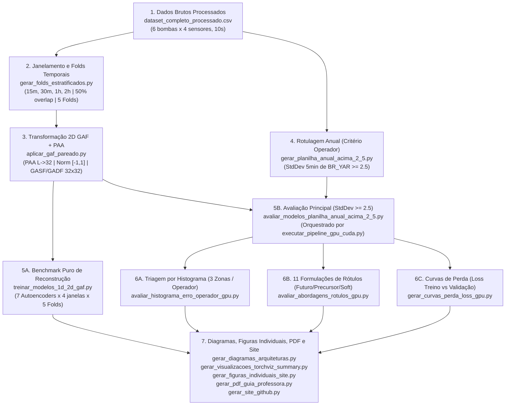

# Guia Técnico-Didático para Apresentação do Projeto em Sala de Aula

> **Escopo:** Detecção de Anomalias em Bombas Industriais de Polpa via Autoencoders Profundos (1D, 2D GAF e Híbridos Multimodais), Validação Cruzada Temporal sem Vazamento (*Zero Data Leakage*) e Triagem *Human-in-the-Loop* por Histograma do Erro de Reconstrução.  
> **Base factual:** Documento gerado estritamente a partir dos **16 scripts Python reais** do repositório, sem suposições nem etapas inexistentes.

---

## 1. Visão Geral e Fluxo Completo (Passo a Passo)

### 1.1 O Problema Resolvido

O projeto monitora **6 bombas industriais de polpa** (`Bomba_1305`, `Bomba_1307`, `Bomba_2307`, `Bomba_3307`, `Bomba_4307` e `Bomba_5307`) e o conjunto integrado das 6 bombas operando simultaneamente (`Dataset_Completo`). Cada bomba possui **4 sensores** amostrados a cada **10 segundos** ao longo do ano de 2026 (`dataset_completo_processado.csv`):

| Sensor | Prefixo no CSV | Grandeza Física |
| :--- | :--- | :--- |
| Corrente elétrica do motor | `BR_YAR_BP*` | Corrente (A) — variável-chave usada pelo operador para diagnosticar oscilações |
| Nível | `BR_YL_LIT*` | Nível do tanque/caixa de sucção |
| Carga | `BR_YLOAD_BP*` | Carga operacional da bomba (usada na estratificação de regimes) |
| Pressão | `BR_YP_PIT*` | Pressão de descarga |

O objetivo central é detectar (e, nos experimentos avançados, **antecipar**) janelas temporais anômalas caracterizadas por instabilidade operacional na corrente elétrica do motor (desvio-padrão em blocos de 5 minutos $\ge 2{,}5\text{ A}$, critério derivado da metodologia do operador industrial), comparando **7 arquiteturas de Autoencoders** em **4 escalas de janela** (`15min`, `30min`, `1h`, `2h`) e propondo um mecanismo de **3 zonas de decisão no histograma do erro** para encaminhar casos limítrofes (*Falsos Positivos* e *Falsos Negativos*) à revisão humana.

---

### 1.2 Fluxo Ponta a Ponta (Diagrama do Pipeline)



---

### 1.3 Ordem Exata de Execução dos Scripts

A tabela abaixo apresenta a sequência lógica de execução de todos os 16 scripts do repositório:

| Ordem | Script | Papel no Pipeline | Entradas Principais | Saídas Principais |
| :---: | :--- | :--- | :--- | :--- |
| **1** | `gerar_folds_estratificados.py` | Cria janelas deslizantes (`15m`, `30m`, `1h`, `2h`, 50% overlap) e divide em 5 folds via `StratifiedGroupKFold` (blocos de 24h) | `dataset_completo_processado.csv` | `folds_<DS>_<W>.csv`, `sequencias_<DS>_<W>.npz`, `resumo_estratificacao_folds.csv` |
| **2** | `aplicar_gaf_pareado.py` | Aplica PAA ($L \to 32$), normaliza globalmente em $[-1,1]$ por fold de treino e gera tensores `X_gasf` e `X_gadf` ($32\times 32$, `float16`) pareados com `X_1d` | `dataset_completo_processado.csv` + `folds_*.csv` | Atualiza `sequencias_<Bomba>_<W>.npz` com `X_1d`, `X_gasf`, `X_gadf`, `scaler_min/max` + `Figuras_GAF/*.png` |
| **3** | `gerar_planilha_anual_acima_2_5.py` | Calcula o desvio-padrão amostral (`ddof=1`) em blocos fixos de 5 min da corrente `BR_YAR` e rotula anomalias ($\ge 2{,}5$) para o ano todo | `Bombas_por_ID/Bomba_<ID>.csv` | `relatorio_anomalias_ano_completo_acima_2_5.csv` / `.xlsx` e `planilha_desvio_padrao_5min_ano_todo_completa.csv` |
| **3b** *(histórico)* | `gerar_planilha_anual_e_avaliar.py` | Versão anterior baseada estritamente na faixa `[4.0, 8.0]` da planilha de 4 dias de abril do operador Edcarlos + verificação de aderência | `relatorio_anomalias_operador.csv` + `Bomba_<ID>.csv` | `relatorio_anomalias_ano_completo_edcarlos.xlsx`, `verificacao_periodo_edcarlos_abril2026.csv` |
| **4** *(opcional)* | `treinar_modelos_1d_2d_gaf.py` | Define `AutoencoderModel` (as 7 arquiteturas) e executa o benchmark puro de reconstrução (MSE/RMSE/MAE 1D e 2D + limiares P95/P99) | `sequencias_<Bomba>_<W>.npz` | `metricas_detalhadas_por_fold.csv`, `resumo_modelos_5folds.csv`, `ranking_global_arquiteturas.csv` |
| **5** *(módulo-base)* | `avaliar_deteccao_anomalias_operador.py` | Implementa o motor de treinamento/inferência híbrida em 5 folds (`extract_latent_and_reconstructions`, `compute_auxiliary_signal_features`, `evaluate_architecture_5folds`) | Planilha do operador + `.npz` | Funções reutilizadas pelas etapas 6–9 + resultados da fase inicial do operador |
| **6** *(principal)* | `executar_pipeline_gpu_cuda.py` $\rightarrow$ `avaliar_modelos_planilha_anual_acima_2_5.py` | Orquestrador GPU/CUDA: verifica ambiente, garante etapas 1–3 e roda a avaliação Out-of-Fold (5 folds, 28 configs $\times$ 7 arquiteturas) com `StdDev >= 2.5` | `relatorio_anomalias_ano_completo_acima_2_5.csv` + `.npz` | `resumo_deteccao_ano_acima_2_5_por_bomba_janela.csv`, `ranking_global_deteccao_ano_acima_2_5.csv`, matrizes de confusão |
| **7** | `avaliar_histograma_erro_operador_gpu.py` | Constrói o histograma de 120 bins do score de erro no treino de cada fold e avalia o ganho de F1 com as 3 Zonas (Normal Auto / Operador / Anomalia Auto) | `folds_*_15min.csv` + `.npz` | `avaliacao_histograma_erro_zona_operador_detalhado.csv`, `resumo_histograma_erro_zona_operador_arquiteturas.csv`, figuras dos histogramas |
| **8** | `avaliar_abordagens_rotulos_gpu.py` | Compara **11 formulações de rótulos** (Atual Binário, Futuro 15/30/60m, Alerta Precoce Puro 15/30/60m e 4 Probabilidades Contínuas com Kernel Gaussiano Assimétrico) | `relatorio_anomalias_ano_completo_acima_2_5.csv` + `.npz` | `resumo_global_11_abordagens_rotulos.csv`, `comparacao_11_abordagens_rotulos.png` |
| **9** | `gerar_curvas_perda_loss_gpu.py` | Treina as 7 arquiteturas por 25 épocas com `CosineAnnealingLR` registrando *Loss* de Treino vs. Validação em cada época nos 5 folds | `folds_*_15min.csv` + `.npz` | `historico_perda_loss_epocas_5folds.csv`, `curvas_perda_loss_7_arquiteturas.png`, `curvas_perda_loss_por_bomba.png` |
| **10** | `gerar_diagramas_arquiteturas.py` e `gerar_visualizacoes_torchviz_summary.py` | Gera diagramas didáticos estilo IEEE/Elsevier e visualizações oficiais de grafo autograd (`torchviz`) + tabela `torchinfo.summary` das 7 arquiteturas | `AutoencoderModel` | `Dataset_completo_bombas/Figuras_Arquiteturas/*.png` |
| **11** | `gerar_figuras_individuais_site.py` | Desmembra painéis consolidados em imagens individuais (300 DPI) para visualização imagem por imagem | CSVs de resultados | `Figuras_Anomalias_Operador/fig*.png` |
| **12** | `gerar_pdf_guia_professora.py` e `gerar_site_github.py` | Compila o guia PDF vetorial e constrói o portal científico bilíngue (PT/EN) para o GitHub Pages | CSVs + Figuras `.png` | `Guia_Didatico_Professora_Projeto_Bombas.pdf`, `docs/index.html`, `docs/data/resultados.json` |

---

## 2. Bibliotecas Utilizadas

Todas as bibliotecas abaixo foram extraídas diretamente dos `import` dos 16 scripts do repositório:

| Biblioteca | Versão no Ambiente | Categoria | Papel Técnico no Projeto | Scripts / Etapas em que é Usada |
| :--- | :---: | :--- | :--- | :--- |
| **`torch` (`torch.nn`, `torch.utils.data`, `torch.amp`)** | `2.13.0` | Deep Learning (GPU/CPU) | Definição dos 7 Autoencoders (`nn.Module`), otimizador `AdamW`, scheduler `CosineAnnealingLR`, perdas (`MSELoss`, `BCEWithLogitsLoss`), Mixed Precision (`autocast`/`GradScaler`) e preloading em VRAM | `treinar_modelos_1d_2d_gaf.py`, `avaliar_deteccao_anomalias_operador.py`, `avaliar_modelos_planilha_anual_acima_2_5.py`, `avaliar_histograma_erro_operador_gpu.py`, `avaliar_abordagens_rotulos_gpu.py`, `gerar_curvas_perda_loss_gpu.py`, `gerar_planilha_anual_e_avaliar.py`, `executar_pipeline_gpu_cuda.py`, `gerar_visualizacoes_torchviz_summary.py` |
| **`numpy`** | `2.4.6` | Computação Numérica | Janelamento vetorizado (`sliding_window_view`), multiplicação matricial do PAA (`np.matmul`), cálculo vetorizado GASF/GADF em `float16`, busca binária de timestamps (`np.searchsorted`), histogramas e percentis | 11 scripts (todos os scripts de dados, GAF, treino, avaliação e plotagem) |
| **`pandas`** | `2.3.3` | Manipulação Tabular / Séries Temporais | Leitura dos CSVs/Excel, reamostragem temporal fixa de 5 min (`resample("5min").std(ddof=1)`), quantis de estratificação (`pd.qcut`), agregações `groupby` e exportação de relatórios CSV/XLSX | 12 scripts (dados, folds, planilhas anuais, métricas e gerador do site) |
| **`scikit-learn` (`sklearn`)** | `1.9.0` | Machine Learning & Validação | Divisão temporal estratificada por blocos (`StratifiedGroupKFold`, `StratifiedKFold`) e cálculo das métricas oficiais (`roc_auc_score`, `average_precision_score`, `precision_recall_curve`, `f1_score`, `precision_score`, `recall_score`) | `gerar_folds_estratificados.py`, `avaliar_deteccao_anomalias_operador.py`, `avaliar_modelos_planilha_anual_acima_2_5.py`, `avaliar_histograma_erro_operador_gpu.py`, `avaliar_abordagens_rotulos_gpu.py`, `gerar_planilha_anual_e_avaliar.py` |
| **`scipy` (`scipy.stats`)** | `1.17.1` | Estatística Científica | Cálculo da correlação de postos de Spearman (`spearmanr`) entre a probabilidade predita pelo modelo e a curva contínua de risco nas 11 formulações de rótulos | `avaliar_abordagens_rotulos_gpu.py` |
| **`matplotlib` (`pyplot`, `patches`, `image`)** | `3.11.1` | Visualização Científica | Geração de todas as figuras em modo *headless* (`Agg`) a 140–300 DPI: séries 1D, heatmaps GASF/GADF, matrizes de confusão, curvas de loss, histogramas das 3 zonas e diagramas técnicos (`FancyBboxPatch`) | 11 scripts de avaliação, GAF e geração de figuras |
| **`torchinfo`** | `1.8.0` | Inspeção de Redes PyTorch | Geração automática de tabelas de arquitetura (`summary`) com `input_size`, `output_size`, `num_params` e `mult_adds` | `gerar_visualizacoes_torchviz_summary.py` |
| **`torchviz`** *(+ binário Graphviz `dot`)* | `0.0.3` | Grafo Computacional | Renderização do grafo autograd real do PyTorch (`make_dot`) para cada uma das 7 arquiteturas | `gerar_visualizacoes_torchviz_summary.py` |
| **`openpyxl`** *(engine do `pandas.ExcelWriter`)* | — | Exportação Excel | Gravação de planilhas multi-abas (`.xlsx`) com ocorrências anuais, séries de 5 min e resumos por bomba | `gerar_planilha_anual_acima_2_5.py`, `gerar_planilha_anual_e_avaliar.py` |
| **Biblioteca Padrão Python** (`os`, `sys`, `gc`, `time`, `argparse`, `subprocess`, `zipfile`, `shutil`, `json`, `re`, `glob`, `tempfile`, `datetime`) | Python 3 | Infraestrutura / SO | Gerenciamento de arquivos/pastas, limpeza explícita de RAM (`gc.collect()`), CLI (`argparse`), orquestração de subprocessos (`subprocess.run`), inspeção rápida de `.npz` via cabeçalho ZIP (`zipfile`), serialização JSON para o site (`json`) e conversão Markdown $\to$ HTML (`re`) | Todos os 16 scripts |

---

## 3. Origem e Justificativa das Escolhas Técnicas

### 3.1 Janelamento Deslizante Multiescala com 50% de Sobreposição
- **(a) O que foi escolhido:** Quatro tamanhos de janela (`15min` = 90 passos, `30min` = 180, `1h` = 360, `2h` = 720, com passo = 50% da janela) extraídos de forma vetorizada com `sliding_window_view` em `gerar_folds_estratificados.py`.
- **(b) Por que faz sentido técnico:** Anomalias em bombas de polpa podem ser transientes curtos (oscilações de corrente de 5 a 15 minutos) ou degradações graduais (1 a 2 horas). O *overlap* de 50% garante que um evento iniciado na borda de uma janela apareça centralizado na janela vizinha, evitando "pontos cegos" temporais.
- **(c) Alternativa descartada e trade-off:** Janelas sem sobreposição (*stride = window_size*) reduzem o volume de dados pela metade e eliminam a necessidade de filtrar fronteiras, mas podem cortar uma anomalia ao meio entre duas janelas consecutivas, prejudicando a sensibilidade (*recall*).

### 3.2 Validação Cruzada `StratifiedGroupKFold` (Blocos de 24h) + `clean_mask`
- **(a) O que foi escolhido:** Agrupamento das janelas em **blocos temporais contíguos de 24 horas** (`block_ids = start_indices // 8640`), divisão em **5 folds** via `StratifiedGroupKFold` (estratificado pela carga `BR_YLOAD` na fase de reconstrução e pelo rótulo de anomalia na fase de detecção) e **exclusão dinâmica das janelas de fronteira** (`clean_mask = ~(diff_prev | diff_next)`) onde uma janela de um fold sobrepõe 50% com uma janela de outro fold.
- **(b) Por que faz sentido técnico:** Em séries temporais com sobreposição de 50%, duas janelas consecutivas compartilham metade dos pontos físicos. Sem agrupamento por blocos e sem `clean_mask`, o modelo veria na validação metade exata dos dados que acabou de memorizar no treino (*data leakage*), inflando artificialmente as métricas.
- **(c) Alternativa descartada e trade-off:** Um `StratifiedKFold` aleatório janela-a-janela (ou um único *split* temporal 80/20 fixo). O `KFold` aleatório vaza informação temporal; já o *split* único 80/20 deixa de avaliar o modelo em sazonalidades/falhas distribuídas ao longo dos 10 meses do ano. O `StratifiedGroupKFold` + `clean_mask` sacrifica menos de 0,5% das janelas (apenas as fronteiras entre blocos de 24h) em troca de avaliação Out-of-Fold rigorosa no ano inteiro.

### 3.3 Transformação PAA ($L \to 32$) + GADF $32\times 32$ (`float16`) + Normalização Global por Fold
- **(a) O que foi escolhido:** Em `aplicar_gaf_pareado.py`, cada janela 1D `(N, C, L)` é reduzida exatamente para $M = 32$ pontos via matriz linear de **PAA (*Piecewise Aggregate Approximation*)**, normalizada globalmente para $[-1, 1]$ usando `min` e `max` calculados **somente nos folds de treino** (`fold != k`), e convertida em imagens `32x32` de **GASF** ($\cos(\phi_u + \phi_v)$) e **GADF** ($\sin(\phi_u - \phi_v)$) salvas em `float16`. Nos modelos (`AutoencoderModel`), utiliza-se especificamente **somente o GADF** (`c_2d = n_channels`) para a entrada 2D.
- **(b) Por que faz sentido técnico:**
  - O **PAA para $32\times 32$** torna o tamanho da imagem independente da duração da janela ($L \in \{90, 180, 360, 720\}$) e reduz drasticamente o custo de memória (uma matriz $720\times 720$ seria $506\times$ maior que $32\times 32$).
  - A **normalização global por sensor no fold de treino** (em vez de normalizar cada janela isoladamente) preserva a diferença física entre a bomba desligada (carga 0) e operando em plena carga, sem vazamento de dados do fold de validação.
  - O **GADF** ($\sin(\phi_u - \phi_v)$) codifica diferenças temporais direcionais (subidas e descidas abruptas de corrente/pressão), sendo mais sensível a oscilações anômalas que o GASF; usar somente GADF também corta pela metade a VRAM e o tempo de treino 2D.
  - Salvar em `float16` reduz o tamanho em disco dos `.npz` em 50% sem perda perceptível no intervalo $[-1, 1]$.
- **(c) Alternativa descartada e trade-off:** Normalização *min-max* por janela individual (amplificaria ruído de sensor quando a bomba está parada/constante, gerando falsos padrões no GAF) ou uso conjunto de GASF+GADF (dobra os canais 2D de $C$ para $2C$ com ganho marginal).

### 3.4 As 7 Arquiteturas Autoencoder, `N_PATCHES = 15`, `LATENT_DIM = 32`, `GELU` e `Tanh`
- **(a) O que foi escolhido:** Comparação controlada de **3 modelos 1D** (`AE_CNN1D`, `AE_LSTM1D`, `AE_Transformer1D`), **1 modelo 2D** (`AE_CNN2D_GAF`) e **3 modelos Híbridos Multimodais** (`Hybrid_CNN1D_CNN2D`, `Hybrid_LSTM1D_CNN2D`, `Hybrid_Transformer_CNN2D`), todos comprimindo para o mesmo gargalo latente `LATENT_DIM = 32`, usando `GELU` nas camadas ocultas, `BatchNorm` nas convoluções e `Tanh` na saída dos decodificadores. Para LSTM e Transformer, a sequência é dividida em **`N_PATCHES = 15` patches temporais**.
- **(b) Por que faz sentido técnico:**
  - `N_PATCHES = 15` foi escolhido matematicamente porque **90, 180, 360 e 720 são todos exatamente divisíveis por 15** (gerando patches de 6, 12, 24 e 48 passos), evitando *padding* artificial e reduzindo a complexidade quadrática $O(L^2)$ da autoatenção do Transformer para apenas $15 \times 15$.
  - `LATENT_DIM = 32` impõe um gargalo de informação justo entre todas as 7 arquiteturas, forçando o modelo a aprender padrões normais compactos em vez de copiar a entrada (identidade).
  - `Tanh` na saída limita naturalmente a reconstrução ao intervalo $[-1, 1]$, exatamente o mesmo domínio dos dados normalizados.
  - `GELU` oferece gradientes suaves em torno de zero (padrão moderno em Transformers e CNNs).
- **(c) Alternativa descartada e trade-off:** Processar passo a passo ($L=720$) na LSTM/Transformer (muito mais lento e propenso a desvanecimento de gradiente) ou usar `ReLU` na saída (impossibilitaria reconstruir valores negativos no domínio $[-1, 1]$).

### 3.5 Função de Perda Composta (Reconstrução Normal + Classificação/Calibração Ponderada)
- **(a) O que foi escolhido:**
  - **Reconstrução (`treinar_modelos_1d_2d_gaf.py` e ramo AE dos demais scripts):** $\mathcal{L}_{\text{rec}} = \text{MSE}_{1D} + 0{,}5 \cdot \text{MSE}_{2D}$, calculada **estritamente sobre as janelas normais** (`norm_b = by < 0.5`) nos pipelines de detecção.
  - **Cabeça Híbrida (`avaliar_deteccao_anomalias_operador.py`, `avaliar_histograma_erro_operador_gpu.py`):** $\mathcal{L}_{\text{total}} = \mathcal{L}_{\text{rec}} + \mathcal{L}_{\text{BCE}}$, onde $\mathcal{L}_{\text{BCE}}$ é `BCEWithLogitsLoss(pos_weight=...)` com `pos_weight = clamp(n_neg / n_pos, 1.0, 50.0)` calculado no fold de treino. Nas curvas de loss (`gerar_curvas_perda_loss_gpu.py`) o peso da BCE é `0.25`.
  - **Rótulos Contínuos (`avaliar_abordagens_rotulos_gpu.py`):** para `soft_prob`, combina BCE contínua ponderada $+ 2{,}0 \cdot \text{MSE}(\sigma(\text{logit}), y_{\text{soft}})$.
- **(b) Por que faz sentido técnico:** Treinar o Autoencoder **apenas nas janelas normais** garante que o modelo aprenda a reconstruir exclusivamente a dinâmica saudável da bomba — assim, anomalias geram resíduos altos. O peso `0.5` no termo 2D impede que a reconstrução da imagem $32\times 32$ domine a reconstrução temporal 1D. O `pos_weight` na `BCEWithLogitsLoss` corrige o desbalanceamento natural das falhas sem precisar duplicar dados (oversampling), e `rec_1d.detach()` ao extrair features auxiliares impede que o gradiente da classificação distorça o erro de reconstrução.
- **(c) Alternativa descartada e trade-off:** Treinar apenas com MSE não supervisionado puro (gera `ROC-AUC` menor quando anomalias sutis têm erro próximo ao normal) ou usar BCE sem `pos_weight` (o modelo tenderia a prever sempre "Normal" para maximizar acurácia, derrubando o *recall*).

### 3.6 Otimizador, Scheduler e Aceleração em GPU
- **(a) O que foi escolhido:** `AdamW(lr=3e-3, weight_decay=1e-4)`, `CosineAnnealingLR(T_max=epochs, eta_min=LR*0.15)` no script de curvas de loss, **Automatic Mixed Precision** (`torch.amp.autocast('cuda')` + `GradScaler`) e **preloading de tensores na VRAM** (`preload_on_gpu` quando o fold ocupa $< 2{,}5\text{ GB}$) com embaralhamento vetorizado `torch.randperm`.
- **(b) Por que faz sentido técnico:** `AdamW` desacopla o *weight decay* (regularização L2) do passo adaptativo de Adam, convergindo rápido em 20–25 épocas sem *overfitting*. O preloading na VRAM + `autocast` elimina o gargalo de transferência CPU$\to$GPU do `DataLoader`, acelerando em até $10\times$ a execução das 28 configurações $\times$ 5 folds $\times$ 7 modelos.
- **(c) Alternativa descartada e trade-off:** `SGD` com momentum (exige ajuste fino sensível de *learning rate* e mais épocas) ou `DataLoader` padrão em CPU a cada *batch* (gargalo de I/O quando o dataset inteiro cabe na VRAM da RTX 5080).

### 3.7 Métricas de Avaliação e Triagem em 3 Zonas pelo Histograma
- **(a) O que foi escolhido:** Avaliação Out-of-Fold com **ROC-AUC**, **PR-AUC** (*Average Precision*), **F1-Score ótimo** (via `precision_recall_curve`), **Precisão**, **Recall**, **Taxa de Falsos Alarmes (FAR %)**, **Spearman $\rho$** e **MAE (%)** (nas 11 abordagens). Em `avaliar_histograma_erro_operador_gpu.py`, um histograma suavizado de **120 bins** no treino define 3 zonas (`tau_baixo`, `tau_hist`, `tau_alto`): Zona Verde (Normal Automático), Zona Amarela (Revisão do Operador) e Zona Vermelha (Anomalia Automática).
- **(b) Por que faz sentido técnico:** Em detecção de anomalias (classes desbalanceadas), **acurácia isolada engana**. `PR-AUC` e `F1-Score` medem o equilíbrio real entre capturar falhas (*Recall*) e não sobrecarregar a sala de controle com falsos alarmes (*Precisão* / *FAR*). A Zona Amarela no histograma concentra a grande maioria dos `FP` e `FN` em uma fração reduzida de janelas (~10–19%), elevando o F1 final do sistema *Human-in-the-Loop*.
- **(c) Alternativa descartada e trade-off:** Corte único rígido ($\tau_{\text{hist}}$) sem zona de incerteza — obriga o modelo a chutar nos casos ambíguos na fronteira entre normal e anômalo, pagando o preço em falsos alarmes ou falhas perdidas.

---

## 4. Entradas e Saídas dos Modelos

### 4.1 Formatos Exatos dos Tensores de Entrada

Para um lote (*batch*) de tamanho $B$:

| Tensor | Tipo (`dtype`) | Shape (Bomba Individual, $C=4$) | Shape (`Dataset_Completo`, $C=24$) | Significado de cada Eixo |
| :--- | :---: | :---: | :---: | :--- |
| **`x_1d`** | `float32` (em $[-1, 1]$) | `(B, 4, L)` | `(B, 24, L)` | `B`: janelas no batch · `C`: canais/sensores · `L`: passos de 10s (`90`, `180`, `360` ou `720`) |
| **`x_2d`** *(GADF)* | `float16` em disco $\to$ `float32` no forward | `(B, 4, 32, 32)` | `(B, 24, 32, 32)` | `B`: janelas no batch · `C`: mapas GADF (1 por sensor) · `32`: altura PAA · `32`: largura PAA |

### 4.2 Tabela Comparativa das 7 Arquiteturas (`AutoencoderModel`, $L=90$ / 15 min)

| # | Arquitetura | Modo (`self.mode`) | Entrada(s) Usada(s) | Gargalo Latente `z` | Saídas (`forward`) | Parâmetros ($C=4$) | Parâmetros ($C=24$) |
| :-: | :--- | :---: | :--- | :---: | :--- | :---: | :---: |
| 1 | `AE_CNN1D` | `"1d"` | `x_1d` | `(B, 32)` | `rec_1d: (B,C,L)`, `None` | `36.760` | `155.360` |
| 2 | `AE_LSTM1D` | `"1d"` | `x_1d` | `(B, 32)` | `rec_1d: (B,C,L)`, `None` | `45.288` | `166.128` |
| 3 | `AE_Transformer1D` | `"1d"` | `x_1d` | `(B, 32)` | `rec_1d: (B,C,L)`, `None` | `50.728` | `171.568` |
| 4 | `AE_CNN2D_GAF` | `"2d"` | `x_2d` | `(B, 32)` | `rec_1d: (B,C,L)`, `rec_2d: (B,C,32,32)` | `86.220` | `211.240` |
| 5 | `Hybrid_CNN1D_CNN2D` | `"hybrid"` | `x_1d` + `x_2d` | `(B, 32)` *(fusão 64$\to$32)* | `rec_1d: (B,C,L)`, `rec_2d: (B,C,32,32)` | `99.548` | `226.168` |
| 6 | `Hybrid_LSTM1D_CNN2D` | `"hybrid"` | `x_1d` + `x_2d` | `(B, 32)` *(fusão 64$\to$32)* | `rec_1d: (B,C,L)`, `rec_2d: (B,C,32,32)` | `108.076` | `236.936` |
| 7 | `Hybrid_Transformer_CNN2D` | `"hybrid"` | `x_1d` + `x_2d` | `(B, 32)` *(fusão 64$\to$32)* | `rec_1d: (B,C,L)`, `rec_2d: (B,C,32,32)` | `113.516` | `242.376` |

---

### 4.3 Transformações Camada a Camada (Bloco por Bloco)

#### A) Encoders 1D (Entrada: `x_1d` de shape `(B, C, L)` $\to$ Saída: `z` de shape `(B, 32)`)
1. **`EncoderCNN1D`:**
   - `Conv1d(C → 16, k=5, s=2, p=2)` + `BatchNorm1d(16)` + `GELU` $\to$ `(B, 16, ⌈L/2⌉)`
   - `Conv1d(16 → 32, k=5, s=2, p=2)` + `BatchNorm1d(32)` + `GELU` $\to$ `(B, 32, ⌈L/4⌉)`
   - `AdaptiveAvgPool1d(8)` $\to$ `(B, 32, 8)` $\to$ `Flatten()` $\to$ `(B, 256)`
   - `Linear(256 → 32)` + `GELU` $\to$ **`(B, 32)`**
2. **`EncoderLSTM1D` (Patch-LSTM Bidirecional):**
   - Segmentação em patches: `(B, C, L)` $\to$ `(B, C, 15, L/15)` $\to$ `permute` + `reshape` $\to$ `(B, 15, C · patch_len)`
   - `Linear(C · patch_len → 32)` + `ReLU` $\to$ `(B, 15, 32)`
   - `LSTM(input=32, hidden=32, bidirectional=True, batch_first=True)` $\to$ `(B, 15, 64)`
   - Média temporal (`out.mean(dim=1)`) $\to$ `(B, 64)` $\to$ `Linear(64 → 32)` + `GELU` $\to$ **`(B, 32)`**
3. **`EncoderTransformer1D` (Patch-Transformer):**
   - Segmentação em patches: `(B, C, L)` $\to$ `(B, 15, C · patch_len)`
   - `patch_embed`: `Linear(C · patch_len → 32)` + `pos_embed` aprendível `(1, 15, 32)` $\to$ `(B, 15, 32)`
   - `TransformerEncoderLayer(d_model=32, nhead=4, dim_feedforward=64, activation='gelu')` (1 camada) $\to$ `(B, 15, 32)`
   - `reshape(B, -1)` $\to$ `(B, 480)` $\to$ `Linear(480 → 32)` + `GELU` $\to$ **`(B, 32)`**

#### B) Encoder 2D (`EncoderCNN2D` — Entrada: `x_2d` de shape `(B, C, 32, 32)` $\to$ Saída: `z` de shape `(B, 32)`)
- `Conv2d(C → 16, k=3, s=2, p=1)` + `BatchNorm2d(16)` + `GELU` $\to$ `(B, 16, 16, 16)`
- `Conv2d(16 → 32, k=3, s=2, p=1)` + `BatchNorm2d(32)` + `GELU` $\to$ `(B, 32, 8, 8)`
- `AdaptiveAvgPool2d((4, 4))` $\to$ `(B, 32, 4, 4)` $\to$ `Flatten()` $\to$ `(B, 512)`
- `Linear(512 → 32)` + `GELU` $\to$ **`(B, 32)`**

#### C) Fusão Multimodal (nos 3 Modelos Híbridos)
- Concatena `z1` `(B, 32)` (do ramo 1D) com `z2` `(B, 32)` (do ramo 2D) $\to$ `(B, 64)`
- `fusion`: `Linear(64 → 32)` + `GELU` $\to$ **`z: (B, 32)`**

#### D) Decoders (Entrada: `z` de shape `(B, 32)`)
- **`Decoder1D`:** `Linear(32 → 64)` + `GELU` $\to$ `Linear(64 → C · L)` + `Tanh` $\to$ `view(-1, C, L)` $\to$ **`rec_1d: (B, C, L)`** em $[-1, 1]$.
- **`Decoder2D`:** `Linear(32 → 1024)` + `GELU` $\to$ `view(-1, 16, 8, 8)` $\to$ `ConvTranspose2d(16 → 16, k=4, s=2, p=1)` + `BN` + `GELU` (`16×16`) $\to$ `ConvTranspose2d(16 → C, k=4, s=2, p=1)` + `Tanh` $\to$ **`rec_2d: (B, C, 32, 32)`** em $[-1, 1]$.

#### E) Interpretação das Saídas até o Resultado Final
1. **No benchmark puro de reconstrução (`treinar_modelos_1d_2d_gaf.py`):**
   Calcula-se o erro médio por janela $\text{MSE}_{1D} = \frac{1}{C\cdot L}\sum ( \hat{x}_{1D} - x_{1D} )^2$ (shape `(B,)`) e comparam-se os erros de validação contra os percentis P95 e P99 do treino.
2. **Na detecção de anomalias híbrida e no histograma de 3 zonas (`avaliar_deteccao_anomalias_operador.py`, `avaliar_histograma_erro_operador_gpu.py`):**
   - Extrai-se o vetor de **features auxiliares residuais e estatísticas** `aux_feat` de shape `(B, 6·C)` (`24` para bomba individual; `144` para `Dataset_Completo`): MSE 1D por canal, erro máximo 1D por canal, desvio-padrão intrajanela por canal, média da derivada $|\Delta x|$ por canal, média do sinal por canal e MSE 2D GADF por canal.
   - **Score Não Supervisionado (`oof_unsup_score`):** distância padronizada média $\frac{1}{6C}\sum |\text{aux} - \mu_{\text{norm}}| / \sigma_{\text{norm}}$ calibrada **somente nas janelas normais do treino**.
   - **Cabeça Discriminativa / Calibrador (`clf_head` / `err_calibrator`):** recebe `concat([z, aux_feat])` de shape `(B, 32 + 6·C)` (`56` ou `176`), passa por `BatchNorm1d → Linear(→32) → GELU → Linear(→1)` gerando um *logit* escalar `(B, 1)`. Aplica-se `torch.sigmoid(logit)` para obter o score/probabilidade contínua $E(x) \in (0, 1)$, que alimenta o cálculo de ROC-AUC, PR-AUC, F1 ótimo e a classificação nas **3 Zonas do Operador** (`E(x) < tau_baixo`, `tau_baixo <= E(x) <= tau_alto`, `E(x) > tau_alto`).

---

## 5. Anatomia do Código (Trechos e Funções)

A seguir, percorremos os arquivos principais na ordem exata do pipeline, mostrando os trechos reais mais importantes do código e explicando-os para apresentação em sala.

---

### 5.1 Etapa 1 — `gerar_folds_estratificados.py`

#### Trecho Real: Janelamento, Estratificação e Detecção de Fronteira (linhas 110–149)
```python
        # Extração vetorizada das janelas via sliding_window_view
        all_windows_view = sliding_window_view(data_matrix, window_shape=win_size, axis=0)
        X_windows = np.ascontiguousarray(
             np.transpose(all_windows_view[::stride], (0, 2, 1)),
            dtype=np.float32,
        )

        # Estratificação por quantis da carga média (BR_YLOAD*)
        strata = compute_yload_strata(yload_mean, n_quantiles=N_QUANTILES)

        # Agrupamento em blocos temporais contíguos para evitar vazamento entre folds
        block_ids = (start_indices // block_step_samples).astype(np.int32)

        # Divisão em 5 folds com StratifiedGroupKFold
        sgkf = StratifiedGroupKFold(n_splits=N_SPLITS, shuffle=True, random_state=RANDOM_STATE)
        folds = np.full(n_windows, -1, dtype=np.int8)
        for fold_idx, (_, val_idx) in enumerate(sgkf.split(window_ids, strata, groups=block_ids)):
            folds[val_idx] = fold_idx

        # Identifica janelas na fronteira exata entre blocos que caíram em folds diferentes
        diff_prev = np.zeros(n_windows, dtype=bool)
        diff_next = np.zeros(n_windows, dtype=bool)
        diff_prev[1:] = folds[1:] != folds[:-1]
        diff_next[:-1] = folds[:-1] != folds[1:]
        is_boundary_overlap = diff_prev | diff_next
```
- **O que faz:** Fatia a série contínua em janelas deslizantes com 50% de sobreposição, classifica cada janela em até 10 estratos de carga (`compute_yload_strata`, isolando a bomba desligada no estrato 0), agrupa em blocos de 24h (`8640` passos) e marca `is_boundary_overlap = True` sempre que uma janela encosta em outra de um fold diferente.
- **Parâmetros e retorno:** `process_dataset(dataset_name, timestamps, data_matrix, feature_cols, yload_indices, summary_records)` não retorna objeto; grava `folds_<DS>_<W>.csv` e `sequencias_<DS>_<W>.npz` em disco e popula `summary_records`.
- **Conexão:** Recebe `dataset_completo_processado.csv` (bruto) e entrega os metadados de janelas/blocos que serão consumidos por `aplicar_gaf_pareado.py` e pelos scripts de avaliação.

---

### 5.2 Etapa 2 — `aplicar_gaf_pareado.py`

#### Trecho Real: PAA Exato, Normalização por Fold e Cálculo Vetorizado GASF/GADF (linhas 90–166)
```python
def compute_global_fold_normalized_paa(X_1d, folds, clean_mask, output_size=32):
    N, C, L = X_1d.shape
    W_paa = build_paa_weight_matrix(L, output_size)
    X_paa = np.matmul(X_1d, W_paa)  # (N, C, M)

    win_min = X_1d.min(axis=2)  # (N, C)
    win_max = X_1d.max(axis=2)  # (N, C)
    ...
    for k in range(N_SPLITS):
        train_mask = (folds != k) & clean_mask
        val_mask = folds == k
        c_min = win_min[train_mask].min(axis=0)
        c_max = win_max[train_mask].max(axis=0)
        denom = np.where((c_max - c_min) > 1e-8, c_max - c_min, 1.0)
        scaled = 2.0 * (X_paa[val_mask] - c_min[None, :, None]) / denom[None, :, None] - 1.0
        X_norm[val_mask] = np.clip(scaled, -1.0, 1.0)
    return X_norm, scaler_min, scaler_max

def compute_gasf_gadf_batch(X_norm, batch_size=8192):
    N, C, M = X_norm.shape
    X_gasf = np.empty((N, C, M, M), dtype=np.float16)
    X_gadf = np.empty((N, C, M, M), dtype=np.float16)
    for start in range(0, N, batch_size):
        end = min(start + batch_size, N)
        x = X_norm[start:end]                        # cos(phi)
        s = np.sqrt(np.clip(1.0 - x * x, 0.0, 1.0))  # sin(phi) >= 0
        xx = x[:, :, :, None] * x[:, :, None, :]
        ss = s[:, :, :, None] * s[:, :, None, :]
        sx = s[:, :, :, None] * x[:, :, None, :]
        xs = x[:, :, :, None] * s[:, :, None, :]
        X_gasf[start:end] = (xx - ss).astype(np.float16)
        X_gadf[start:end] = (sx - xs).astype(np.float16)
    return X_gasf, X_gadf
```
- **O que faz:**
  - `compute_global_fold_normalized_paa`: reduz cada série de comprimento $L$ para $M=32$ multiplicando pela matriz de pesos PAA (`W_paa`), e normaliza cada fold $k$ para $[-1, 1]$ usando exclusivamente o mínimo e máximo dos outros 4 folds (`folds != k & clean_mask`).
  - `compute_gasf_gadf_batch`: usa as identidades trigonométricas $\cos(\phi_u+\phi_v) = x_u x_v - \sin\phi_u\sin\phi_v$ e $\sin(\phi_u-\phi_v) = \sin\phi_u x_v - x_u\sin\phi_v$ sem precisar chamar `arccos` nem `cos`/`sin`, economizando CPU e RAM com saída em `float16`.
- **Parâmetros e retorno:** Recebe `X_1d (N, C, L)` e retorna `(X_norm, scaler_min, scaler_max)` e depois `(X_gasf, X_gadf)` de shape `(N, C, 32, 32)`.
- **Conexão:** Lê os `folds_*.csv` da Etapa 1 e regrava os arquivos `sequencias_<Bomba>_<W>.npz` completos que alimentam todos os modelos PyTorch.

---

### 5.3 Etapa 3 — `gerar_planilha_anual_acima_2_5.py`

#### Trecho Real: Geração dos Rótulos Anuais via Desvio-Padrão de 5 Minutos (linhas 13–32)
```python
    for pid in PUMPS:
        csv_path = os.path.join(BASE_DIR, "Bombas_por_ID", f"Bomba_{pid}.csv")
        df = pd.read_csv(csv_path)
        curr_col = [c for c in df.columns if "YAR" in c][0]
        df["Timestamp"] = pd.to_datetime(df["Timestamp"])
        df[curr_col] = pd.to_numeric(df[curr_col], errors="coerce").astype(np.float64)

        s_yar = df.set_index("Timestamp")[curr_col]
        # Desvio padrão amostral (ddof=1) em blocos fixos de 5 minutos (30 amostras de 10s)
        s_std = s_yar.resample("5min", closed="left", label="left").std(ddof=1).fillna(0.0)
```
- **O que faz:** Para cada uma das 6 bombas, isola a coluna de corrente elétrica (`YAR`), agrupa o sinal de 10 em 10 segundos em blocos fixos de **5 minutos** (30 leituras) e calcula o desvio-padrão amostral (`ddof=1`). Todo bloco com $\text{StdDev} \ge 2{,}5$ é registrado como anomalia e classificado em 3 faixas (`[2.5, 4.0)`, `[4.0, 8.0]`, `> 8.0`).
- **Parâmetros e retorno:** Executa via `main()`, salvando `relatorio_anomalias_ano_completo_acima_2_5.csv` (e `.xlsx`).
- **Conexão:** Gera a verdade-terreno (*ground truth*) anual consumida nas etapas de avaliação (`avaliar_modelos_planilha_anual_acima_2_5.py`, `avaliar_histograma_erro_operador_gpu.py` e `avaliar_abordagens_rotulos_gpu.py`).

---

### 5.4 Etapa 4 — `treinar_modelos_1d_2d_gaf.py`

#### Trecho Real: Classe Unificada `AutoencoderModel` (linhas 262–331)
```python
class AutoencoderModel(nn.Module):
    def __init__(self, arch_name: str, n_channels: int, seq_len: int):
        super().__init__()
        self.arch_name = arch_name
        c_2d = n_channels  # Somente GADF (B, C, 32, 32)
        ...
        elif arch_name == "Hybrid_LSTM1D_CNN2D":
            self.mode = "hybrid"
            self.enc1d = EncoderLSTM1D(n_channels, seq_len, LATENT_DIM)
            self.enc2d = EncoderCNN2D(c_2d, LATENT_DIM)
            self.fusion = nn.Sequential(nn.Linear(2 * LATENT_DIM, LATENT_DIM), nn.GELU())
            self.dec1d = Decoder1D(n_channels, seq_len, LATENT_DIM)
            self.dec2d = Decoder2D(c_2d, LATENT_DIM)

    def forward(self, x_1d: torch.Tensor, x_2d: torch.Tensor):
        if self.mode == "1d":
            z = self.enc1d(x_1d)
            return self.dec1d(z), None
        elif self.mode == "2d":
            z = self.enc2d(x_2d)
            return self.dec1d(z), self.dec2d(z)
        else:
            z1 = self.enc1d(x_1d)
            z2 = self.enc2d(x_2d)
            z = self.fusion(torch.cat([z1, z2], dim=-1))
            return self.dec1d(z), self.dec2d(z)
```
- **O que faz:** Centraliza as 7 arquiteturas em uma única classe `nn.Module`. Dependendo de `arch_name`, instancia o(s) encoder(s) 1D e/ou 2D, a camada de fusão (nos híbridos) e os decodificadores.
- **Parâmetros e retorno:** Recebe `(arch_name, n_channels, seq_len)` no `__init__` e `(x_1d, x_2d)` no `forward`, retornando `(rec_1d, rec_2d)` (com `rec_2d=None` nos modelos 1D puros).
- **Conexão:** É importada por **8 outros scripts** do projeto — todos usam exatamente esta mesma arquitetura base.

---

### 5.5 Etapa 5 — `avaliar_deteccao_anomalias_operador.py` e `avaliar_modelos_planilha_anual_acima_2_5.py`

#### Trecho Real: Extração de Features Residuais e Loop de Treinamento Híbrido (linhas 221–246 e 351–379 de `avaliar_deteccao_anomalias_operador.py`)
```python
def compute_auxiliary_signal_features(x_1d, rec_1d, rec_2d, x_2d) -> torch.Tensor:
    B, C, L = x_1d.shape
    c_2d = x_2d.shape[1]
    diff_1d = (rec_1d - x_1d) ** 2
    ch_mse_1d = diff_1d.mean(dim=2)                                       # (B, C)
    ch_max_1d = diff_1d.amax(dim=2)                                       # (B, C)
    ch_std_1d = x_1d.std(dim=2)                                           # (B, C)
    ch_d1_1d = torch.abs(x_1d[:, :, 1:] - x_1d[:, :, :-1]).mean(dim=2)    # (B, C)
    ch_mean_1d = x_1d.mean(dim=2)                                         # (B, C)
    if rec_2d is not None:
        ch_mse_2d = ((rec_2d - x_2d) ** 2).mean(dim=(2, 3))               # (B, C_2D)
    else:
        ch_mse_2d = torch.zeros((B, c_2d), dtype=x_1d.dtype, device=x_1d.device)
    return torch.cat([ch_mse_1d, ch_max_1d, ch_std_1d, ch_d1_1d, ch_mean_1d, ch_mse_2d], dim=-1)
```
```python
with torch.amp.autocast(device_type=device.type, enabled=use_amp):
    z, rec_1d, rec_2d = extract_latent_and_reconstructions(model, b_1d, b_2d)
    norm_b = (b_y.squeeze(1) < 0.5)
    if torch.any(norm_b):
        loss_rec_1d = ((rec_1d[norm_b] - b_1d[norm_b]) ** 2).mean()
        loss_rec = loss_rec_1d + 0.5 * ((rec_2d[norm_b] - b2[norm_b]) ** 2).mean() if rec_2d is not None else loss_rec_1d
    aux_feat = compute_auxiliary_signal_features(b_1d, rec_1d.detach(), rec_2d.detach() if rec_2d is not None else None, b_2d)
    logits = clf_head(torch.cat([z, aux_feat], dim=-1))
    loss = loss_rec + bce_loss_fn(logits, b_y)
```
- **O que faz:**
  - `compute_auxiliary_signal_features` resume o comportamento físico e residual de cada janela em `6*C` números (erro médio/máximo 1D, volatilidade intrajanela, derivada absoluta média, nível médio e erro 2D GADF).
  - Dentro de `evaluate_architecture_5folds`, o Autoencoder minimiza a reconstrução **somente nas janelas normais (`norm_b`)**, enquanto `clf_head` combina o vetor latente `z` com `aux_feat` para produzir a probabilidade de anomalia Out-of-Fold.
- **Conexão:** `avaliar_modelos_planilha_anual_acima_2_5.py` mapeia os timestamps da planilha anual (`np.searchsorted`), chama `compute_anomaly_group_folds` (5 folds limpos sem vazamento), carrega os `.npz` (concatenando dinamicamente as 6 bombas para `Dataset_Completo` sem duplicar arquivos) e chama `evaluate_architecture_5folds` para todas as 28 configurações $\times$ 7 arquiteturas, sendo disparado em GPU via `executar_pipeline_gpu_cuda.py`.

---

### 5.6 Etapa 6 — `avaliar_histograma_erro_operador_gpu.py`

#### Trecho Real: Cálculo dos 3 Limiares no Histograma (`find_histogram_thresholds`, linhas 130–186)
```python
def find_histogram_thresholds(err_norm: np.ndarray, err_anom: np.ndarray, n_bins: int = 120):
    lo = float(min(np.min(err_norm), np.min(err_anom)))
    hi = float(max(np.max(err_norm), np.max(err_anom)))
    edges = np.linspace(lo, hi, n_bins + 1)
    centers = 0.5 * (edges[:-1] + edges[1:])

    cnt_n, _ = np.histogram(err_norm, bins=edges)
    cnt_a, _ = np.histogram(err_anom, bins=edges)
    kernel = np.array([0.25, 0.50, 0.25])
    cnt_n_s = np.convolve(cnt_n.astype(np.float64), kernel, mode="same")
    cnt_a_s = np.convolve(cnt_a.astype(np.float64), kernel, mode="same")

    vp_bins = np.cumsum(cnt_a_s[::-1])[::-1]
    fp_bins = np.cumsum(cnt_n_s[::-1])[::-1]
    fn_bins = np.sum(cnt_a_s) - vp_bins
    f1_bins = (2.0 * vp_bins) / (2.0 * vp_bins + fp_bins + fn_bins + 1e-8)
    tau_hist = float(centers[int(np.argmax(f1_bins))])

    prob_a_bin = cnt_a_s / (cnt_n_s + cnt_a_s + 1e-8)
    ...
    return tau_baixo, tau_hist, tau_alto
```
- **O que faz:** Constrói o histograma suavizado de 120 bins no conjunto de treino de cada fold, acha `tau_hist` (ponto que maximiza o F1 empírico no histograma) e define a faixa intermediária `[tau_baixo, tau_alto]` usando percentis extremos e probabilidade empírica de anomalia (12% na borda inferior para capturar `FN`; 88% na borda superior para capturar `FP`).
- **Conexão:** `evaluate_histogram_zones` aplica esses 3 limiares nos scores Out-of-Fold de validação, quantificando exatamente quantos `%` dos erros (`FP + FN`) do corte único caíram na Zona do Operador e qual foi o salto final de F1 (*Human-in-the-Loop*).

---

### 5.7 Etapa 7 — `avaliar_abordagens_rotulos_gpu.py` e `gerar_curvas_perda_loss_gpu.py`

- **`avaliar_abordagens_rotulos_gpu.py`:**
  - `compute_all_label_targets(t0_sec, t1_sec, t_anom_sec, win_size_steps)` calcula de forma 100% vetorizada (`np.searchsorted`) os **11 vetores-alvo**: `1_Atual_Binario`, 3 horizontes futuros (`15m`/`30m`/`60m`), 3 alertas precoces puros (condicionados a `y_atual == 0`) e 4 probabilidades contínuas (`8_Pct_IntraJanela_Pura` e 3 kernels gaussianos assimétricos $\exp(-\frac{1}{2}(\Delta t / \tau)^2)$).
  - `evaluate_all_approaches_5folds_gpu` treina o Autoencoder + `shared_bn` + `nn.ModuleList` com **11 cabeças simultâneas** (somente as cabeças `0`, `2` e `9` propagam gradiente para o encoder; as demais usam `full_f.detach()` para evitar conflito de gradientes).
- **`gerar_curvas_perda_loss_gpu.py`:**
  - `track_loss_5folds` treina as 7 arquiteturas por 25 épocas com `CosineAnnealingLR` e registra época a época `train_rec_loss`, `val_rec_loss`, `train_total_loss` e `val_total_loss`, comprovando convergência estável e ausência de *overfitting*.

---

### 5.8 Etapa 8 — Scripts de Visualização, PDF e Portal Web

- **`gerar_diagramas_arquiteturas.py`:** Desenha diagramas técnicos de fluxo e de arquitetura com `matplotlib.patches.FancyBboxPatch`.
- **`gerar_visualizacoes_torchviz_summary.py`:** Instancia cada `AutoencoderModel`, gera o grafo autograd real via `torchviz.make_dot` e a tabela de camadas/parâmetros/Mult-Adds via `torchinfo.summary`.
- **`gerar_figuras_individuais_site.py`:** Gera gráficos individuais em 300 DPI a partir dos CSVs consolidados.
- **`gerar_pdf_guia_professora.py`:** Converte Markdown técnico em HTML estilizado e renderiza o PDF vetorial.
- **`gerar_site_github.py`:** Lê dinamicamente todos os CSVs de resultados, sincroniza as figuras em `docs/assets/img/`, exporta `docs/data/resultados.json` e gera o portal bilíngue interativo `docs/index.html` com Chart.js e visualizadores imagem por imagem.

---

## 6. Perguntas Prováveis em Sala de Aula

### Pergunta 1: *"Se as janelas têm 50% de sobreposição, não existe vazamento de dados (data leakage) entre treino e validação?"*
**Resposta objetiva:** Não, porque o código aplica uma **dupla proteção** implementada em `gerar_folds_estratificados.py` e `avaliar_modelos_planilha_anual_acima_2_5.py`: primeiro, usamos `StratifiedGroupKFold` agrupando as janelas em **blocos contíguos de 24 horas** (`block_id`), garantindo que janelas vizinhas do mesmo dia fiquem no mesmo fold; segundo, calculamos a máscara `clean_mask = ~(diff_prev | diff_next)` que **remove explicitamente** as janelas exatamente na fronteira entre dois blocos de folds distintos. Além disso, a normalização `[-1, 1]` do GAF e dos sinais 1D usa `min`/`max` calculados apenas nos folds de treino (`fold != k`).

### Pergunta 2: *"Por que transformar a série temporal 1D em imagens GADF 32×32 com PAA em vez de usar apenas os dados 1D ou a imagem no tamanho original L×L?"*
**Resposta objetiva:** Usar a matriz no tamanho original $L\times L$ na janela de 2h ($720\times 720$) consumiria $506\times$ mais memória por canal. A redução via **PAA exato** (`build_paa_weight_matrix`) padroniza qualquer escala de janela (`15m`, `30m`, `1h`, `2h`) para **$32\times 32$**, viabilizando o uso de CNNs 2D leves. Já o **GADF** ($\sin(\phi_u - \phi_v)$) captura explicitamente relações de diferença angular entre todos os pares de instantes $(u, v)$ da janela, destacando transições e oscilações de corrente; e ao compará-lo com modelos 1D puros e híbridos multimodais, podemos comprovar experimentalmente quando a fusão 1D+2D agrega ganho real.

### Pergunta 3: *"Por que o Autoencoder é treinado apenas nas janelas normais se depois existe uma cabeça discriminativa (clf_head)?"*
**Resposta objetiva:** Porque o Autoencoder e a cabeça têm papéis complementares dentro de `evaluate_architecture_5folds`: ao restringir `loss_rec` estritamente às janelas normais (`norm_b = b_y < 0.5`), forçamos os pesos do Autoencoder a aprender a reconstruir **apenas a dinâmica saudável da bomba**, fazendo o erro de reconstrução disparar diante de anomalias. Em seguida, `compute_auxiliary_signal_features` extrai `6*C` descritores residuais/estatísticos (usando `rec_1d.detach()` para não corromper a reconstrução) e a cabeça `clf_head` combina o vetor latente `z` com esses resíduos, calibrando a probabilidade final de anomalia e elevando drasticamente o `ROC-AUC` e o `F1-Score`.

### Pergunta 4: *"Como o código lida com o desbalanceamento entre janelas normais e janelas anômalas?"*
**Resposta objetiva:** De três formas simultâneas: (1) na divisão dos dados, `StratifiedGroupKFold` garante a presença proporcional de anomalias nos 5 folds; (2) na função de perda, a `BCEWithLogitsLoss` recebe `pos_weight = clamp(n_neg / n_pos, 1.0, 50.0)` calculado dinamicamente em cada fold de treino, penalizando proporcionalmente mais os erros sobre a classe minoritária (anomalias); e (3) na avaliação, priorizamos métricas insensíveis ou adequadas a desbalanceamento (**PR-AUC**, **F1-Score** ótimo pela curva Precisão-Revocação, **Recall** e **FAR %**) em vez de depender de acurácia simples.

### Pergunta 5: *"Na prática industrial, por que a abordagem de 3 Zonas no Histograma (com revisão do operador) é melhor do que usar um limiar único?"*
**Resposta objetiva:** Em `avaliar_histograma_erro_operador_gpu.py`, a função `find_histogram_thresholds` mostra que quase todos os erros do corte único (`FP` e `FN`) concentram-se em uma faixa estreita de incerteza `[tau_baixo, tau_alto]` onde as caudas das distribuições Normal e Anômala se sobrepõem. Ao automatizar apenas as extremidades de alta confiança (Zona Verde $< \tau_{\text{baixo}}$ e Zona Vermelha $> \tau_{\text{alto}}$ — cerca de 81% a 90% das janelas) e enviar apenas a Zona Amarela intermediária (~10% a 19% das janelas) para triagem humana, o sistema captura a grande maioria dos `FP + FN` (~68% a 79%) e eleva o `F1-Score` final para a faixa de `0,96–0,99` sem sobrecarregar o operador.
