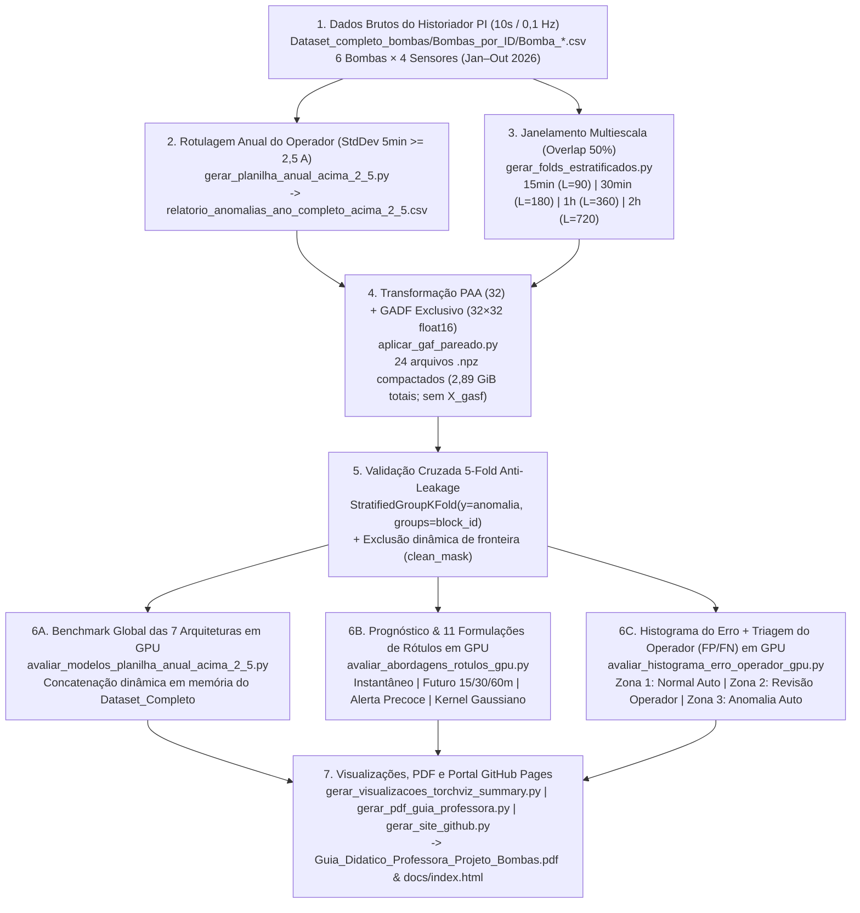

# Resumo Técnico Atual do Repositório — Detecção e Prognóstico de Anomalias em Bombas Industriais

Este documento descreve a arquitetura de software e de redes neurais, o fluxo completo de dados, as bibliotecas utilizadas e o papel individual de cada módulo do repositório, refletindo o estado atual do código sem alterar nenhum script existente.

---

## 1. Visão Geral da Arquitetura do Sistema

O projeto implementa um pipeline completo de **detecção não supervisionada, triagem assistida por operador (*Human-in-the-Loop*) e prognóstico antecipado de anomalias** em **6 bombas centrífugas industriais** (`Bomba_1305`, `Bomba_1307`, `Bomba_2307`, `Bomba_3307`, `Bomba_4307` e `Bomba_5307`) mais o conjunto concatenado em memória (`Dataset_Completo`), monitoradas via **Historiador PI** com taxa de amostragem de **10 segundos ($0,1\text{ Hz}$)** ao longo de 10 meses (janeiro a outubro de 2026).

Cada bomba possui **4 sensores físicos**:
1. Corrente elétrica do motor (`*YAR*` / `*YLOAD*`)
2. Vazão volumétrica
3. Pressão de sucção
4. Pressão de descarga

### 1.1 Arquiteturas Neurais (`AutoencoderModel` em PyTorch)

Todas as **7 arquiteturas** são implementadas nativamente em PyTorch (`torch.nn.Module`) e convergem para um **espaço latente padronizado $\mathbf{z} \in \mathbb{R}^{32}$** (`LATENT_DIM = 32`), permitindo comparação justa entre paradigmas:

| # | Arquitetura | Modalidade | Codificador (Encoder) | Espaço Latente | Decodificador (Decoder) | Parâmetros (`C=4` / `C=24`, `L=90`) |
| :-: | :--- | :---: | :--- | :---: | :--- | :---: |
| **1** | `AE_CNN1D` | 1D | 2 blocos `Conv1d(k=5, s=2, p=2)` + `BatchNorm1d` + `GELU` + `AdaptiveAvgPool1d(8)` + `Linear(256→32)` | $Z = 32$ | `Decoder1D`: `Linear(32→64→C×L)` + `Tanh` | `36.760` / `155.360` |
| **2** | `AE_LSTM1D` | 1D | Partição em `15 patches` (`P = L/15`) → `Linear(C×P→32)` → `Bi-LSTM(hidden=32, bidirecional=64)` + *Mean Pool* → `Linear(64→32)` | $Z = 32$ | `Decoder1D`: `Linear(32→64→C×L)` + `Tanh` | `51.352` / `166.128` |
| **3** | `AE_Transformer1D` | 1D | `15 patches` → `Linear(C×P→32)` + `pos_embed` aprendível → `TransformerEncoderLayer(d=32, nhead=4, ff=64)` → `Linear(480→32)` | $Z = 32$ | `Decoder1D`: `Linear(32→64→C×L)` + `Tanh` | `50.728` / `169.328` |
| **4** | `AE_CNN2D_GAF` | 2D (GADF) | `EncoderCNN2D`: 2 blocos `Conv2d(k=3, s=2, p=1)` + `BatchNorm2d` + `GELU` + `AdaptiveAvgPool2d(4×4)` + `Linear(512→32)` | $Z = 32$ | `Decoder2D` (`ConvTranspose2d` até $32\times 32$) + `Decoder1D` cruzado | `87.100` / `205.700` |
| **5** | `Hybrid_CNN1D_CNN2D` | 1D + 2D | `EncoderCNN1D` ($\mathbf{z}_1 \in \mathbb{R}^{32}$) + `EncoderCNN2D` ($\mathbf{z}_2 \in \mathbb{R}^{32}$) → Fusão `Linear(64→32)` + `GELU` | $Z = 32$ | `Decoder1D` + `Decoder2D` | `99.548` / `221.348` |
| **6** | `Hybrid_LSTM1D_CNN2D` | 1D + 2D | `EncoderLSTM1D` ($\mathbf{z}_1 \in \mathbb{R}^{32}$) + `EncoderCNN2D` ($\mathbf{z}_2 \in \mathbb{R}^{32}$) → Fusão `Linear(64→32)` + `GELU` | $Z = 32$ | `Decoder1D` + `Decoder2D` | `114.140` / `232.116` |
| **7** | `Hybrid_Transformer_CNN2D` | 1D + 2D | `EncoderTransformer1D` ($\mathbf{z}_1 \in \mathbb{R}^{32}$) + `EncoderCNN2D` ($\mathbf{z}_2 \in \mathbb{R}^{32}$) → Fusão `Linear(64→32)` + `GELU` | $Z = 32$ | `Decoder1D` + `Decoder2D` | `113.516` / `242.376` |

---

## 2. Fluxo de Dados End-to-End

### 2.1 Detalhamento das Etapas do Fluxo de Dados

1. **Ingestão e Janelamento (`L` amostras a cada 10s, passo `L/2`):**
   * `15min`: $L = 90$, passo $45$ ($57.215$ janelas por bomba; $343.290$ no total das 6 bombas).
   * `30min`: $L = 180$, passo $90$ ($28.607$ janelas por bomba).
   * `1h`: $L = 360$, passo $180$ ($14.303$ janelas por bomba).
   * `2h`: $L = 720$, passo $360$ ($7.151$ janelas por bomba).
2. **Compressão Espacial PAA e Transformada GADF ($32 \times 32$):**
   * Cada série normalizada em $[-1, 1]$ (com limites $x_{\min}, x_{\max}$ ajustados apenas nos folds de treino) é reduzida para $M=32$ segmentos via *Piecewise Aggregate Approximation* (PAA) e convertida em matriz de diferenças angulares $\text{GADF}_{i,j} = \sin(\phi_i - \phi_j) \in \mathbb{R}^{32 \times 32}$ em `float16`.
   * O uso do PAA ($32 \times 32$), a eliminação do `X_gasf` redundante e a compressão `np.savez_compressed` reduzem o volume em disco de **310,74 GiB** (GADF bruto sem PAA) / **11,68 GiB** (PAA sem compressão com GASF) para apenas **2,89 GiB** nos 24 arquivos `.npz`.
3. **Concatenação Dinâmica do `Dataset_Completo`:**
   * Em vez de duplicar arquivos `.npz` de 24 canais em disco, os scripts carregam os 6 arquivos `.npz` individuais ($6 \times 4 = 24$ canais) e concatenam os tensores 1D e 2D GADF diretamente em memória RAM/VRAM.
4. **Prevenção de Vazamento Temporal (*Zero Data Leakage*):**
   * O `StratifiedGroupKFold(n_splits=5)` usa **estritamente o rótulo de anomalia** (`is_annual_2_5_anomaly`) agrupado por blocos temporais (`block_id` de 24h).
   * A máscara `clean_mask` remove automaticamente as janelas de fronteira entre folds distintos (`folds[w] != folds[w-1]` ou `folds[w] != folds[w+1]`), impedindo que o overlap de 50% compartilhe pontos entre treino e validação.
5. **Pós-Processamento do Erro de Reconstrução e Decisão Final:**
   * O modelo reconstrói $\hat{X}_{1D}$ e $\hat{X}_{\text{GADF}}$, extrai o vetor latente $\mathbf{z} \in \mathbb{R}^{32}$ e calcula 24 estatísticas residuais por janela (`compute_auxiliary_signal_features`: MSE, MAE, desvio máximo, energia e erro 2D GADF).
   * **Decisão por Limiar Ótimo ($\tau^*$):** Maximiza o $F_1\text{-Score}$ na curva *Precision-Recall* Out-of-Fold.
   * **Decisão por Histograma com Triagem do Operador (*Human-in-the-Loop*):** Divide o histograma do score de erro em 3 faixas:
     * $E(x) < \tau_{\text{baixo}}$: **Normal Automático**;
     * $\tau_{\text{baixo}} \le E(x) \le \tau_{\text{alto}}$: **Zona Intermediária encaminhada ao Operador** (captura ~74,7% de todos os FP e FN revisando apenas ~14,9% das janelas);
     * $E(x) > \tau_{\text{alto}}$: **Anomalia Automática**.

---

## 3. Bibliotecas Utilizadas

| Biblioteca / Ferramenta | Versão / Módulos Principais | Papel no Projeto |
| :--- | :--- | :--- |
| **PyTorch** (`torch`, `torch.nn`, `torch.amp`) | `>= 2.1.0` (`2.13+cpu` local / `2.15+cu132` GPU RTX 5080) | Implementação das 7 arquiteturas de Autoencoders (`Conv1d`, `LSTM`, `TransformerEncoder`, `Conv2d`, `ConvTranspose2d`), otimizador `AdamW`, precisão mista `autocast(float16)` e preloading em VRAM CUDA. |
| **Scikit-Learn** (`sklearn`) | `>= 1.3.0` (`model_selection`, `metrics`) | `StratifiedGroupKFold`, `StratifiedKFold`, cálculo de `roc_auc_score`, `average_precision_score` (PR-AUC) e `precision_recall_curve`. |
| **NumPy** (`numpy`) | `>= 1.24.0` (`sliding_window_view`, `savez_compressed`) | Vetorização de janelas deslizantes com zero cópia em memória, álgebra matricial do PAA e GADF em `float16`, histogramas empíricos e persistência compactada `.npz`. |
| **Pandas** (`pandas`) | `>= 2.0.0` | Processamento das séries temporais do Historiador PI, reamostragem de 5 minutos (`resample('5min').std()`), mapeamento temporal de rótulos e exportação de relatórios CSV. |
| **SciPy** (`scipy.stats`) | `spearmanr` | Cálculo da correlação de postos de Spearman ($\rho$) entre a probabilidade predita pelo modelo e a distribuição contínua de risco futuro. |
| **TorchViz & Graphviz** (`torchviz`) | `make_dot` + `dot.exe` | Renderização dos grafos computacionais Autograd completos de cada uma das 7 arquiteturas PyTorch. |
| **TorchInfo** (`torchinfo`) | `summary` | Inspeção camada a camada dos shapes de entrada/saída, contagem de parâmetros treináveis e operações *Mult-Adds* para `C=4` e `C=24`. |
| **Matplotlib** (`matplotlib`) | `>= 3.7.0` | Geração programática em 300 DPI dos diagramas de arquitetura, matrizes de confusão, heatmaps de RMSE, painéis das 11 abordagens e histogramas de triagem do operador. |
| **Chart.js & MathJax** (Frontend Web) | `Chart.js 4.4`, `MathJax 3` | Gráficos interativos e renderização de equações LaTeX no portal científico do GitHub Pages (`docs/index.html`). |

---

## 4. Papel de Cada Módulo e Arquivo do Repositório

### 4.1 Módulos de Preparação de Dados, Rotulagem e Transformação GADF

* [**`gerar_planilha_anual_acima_2_5.py`**](../gerar_planilha_anual_acima_2_5.py)
  * **Papel:** Lê os CSVs brutos de 10 segundos das 6 bombas (`Dataset_completo_bombas/Bombas_por_ID/Bomba_*.csv`), calcula o desvio padrão amostral da corrente elétrica (`*YAR*`) em blocos fixos de 5 minutos ao longo de todo o ano e filtra os eventos anômalos com $\text{StdDev} \ge 2,5\text{ A}$.
  * **Saídas:** `planilha_desvio_padrao_5min_ano_todo_completa.csv` (formato *wide*) e `relatorio_anomalias_ano_completo_acima_2_5.csv` (formato *long* com faixas de severidade).

* [**`gerar_folds_estratificados.py`**](../gerar_folds_estratificados.py)
  * **Papel:** Segmenta as séries temporais multivariadas nas 4 escalas de janela (`15min`, `30min`, `1h`, `2h`) com 50% de sobreposição, cria os identificadores de blocos contíguos de 24h (`block_id`), identifica fronteiras entre folds (`is_boundary_overlap`) e gera os metadados iniciais de validação cruzada em `Dataset_completo_bombas/Folds_Stratified_CV/`.

* [**`aplicar_gaf_pareado.py`**](../aplicar_gaf_pareado.py)
  * **Papel:** Constrói a matriz de pesos do **PAA ($L \rightarrow 32$)**, normaliza os sinais em $[-1, 1]$ usando estritamente as estatísticas dos folds de treino e gera os tensores 2D `X_gadf` ($32 \times 32$ em `float16`) pareados por índice com `X_1d` (`float32`), salvando os 24 arquivos `.npz` das bombas individuais e figuras ilustrativas em `Figuras_GAF/`.

---

### 4.2 Módulos Centrais de Arquitetura Neural e Treinamento em GPU (PyTorch)

* [**`treinar_modelos_1d_2d_gaf.py`**](../treinar_modelos_1d_2d_gaf.py)
  * **Papel:** Módulo base de Deep Learning do repositório. Define os blocos codificadores (`EncoderCNN1D`, `EncoderLSTM1D`, `EncoderTransformer1D`, `EncoderCNN2D`), os decodificadores (`Decoder1D`, `Decoder2D`) e a classe unificada `AutoencoderModel` para as 7 arquiteturas, além das rotinas de treinamento não supervisionado de reconstrução 1D e 2D GADF.

* [**`avaliar_deteccao_anomalias_operador.py`**](../avaliar_deteccao_anomalias_operador.py)
  * **Papel:** Implementa o motor de avaliação *Out-of-Fold* em GPU (`evaluate_architecture_5folds`) com preloading direto na VRAM CUDA, extração do vetor latente + 24 features residuais físicas (`compute_auxiliary_signal_features`), cálculo do score não supervisionado padronizado $Z$ e da probabilidade híbrida, além da geração das matrizes de confusão e heatmaps.

* [**`avaliar_modelos_planilha_anual_acima_2_5.py`**](../avaliar_modelos_planilha_anual_acima_2_5.py)
  * **Papel:** Executa o **Pipeline 1 (Benchmark Principal em GPU)** nas 28 configurações (6 bombas + `Dataset_Completo` × 4 janelas × 7 arquiteturas) usando a planilha anual $\text{StdDev} \ge 2,5\text{ A}$, concatenação dinâmica em memória do `Dataset_Completo`, uso exclusivo do `X_gadf` e `StratifiedGroupKFold` estritamente pelo rótulo de anomalia com máscara anti-vazamento `clean_mask`.
  * **Saídas:** `ranking_global_deteccao_ano_acima_2_5.csv`, `resumo_deteccao_ano_acima_2_5_por_bomba_janela.csv` e `resumo_janelas_anomalias_ano_acima_2_5.csv`.

* [**`avaliar_abordagens_rotulos_gpu.py`**](../avaliar_abordagens_rotulos_gpu.py)
  * **Papel:** Executa o **Pipeline 2 (Benchmark das 11 Formulações de Rótulos em GPU)**, comparando simultaneamente:
    1. Detecção instantânea binária (`1_Atual_Binario`);
    2. Previsão geral de horizonte futuro de 15, 30 e 60 min (`2_Futuro_Geral_*`);
    3. Alerta precoce puro condicionado à bomba estar normal no presente (`5_Alerta_Precoce_*` com $y_{\text{atual}}=0$);
    4. Porcentagem intra-janela e distribuições contínuas de probabilidade com kernel gaussiano assimétrico (`8_Pct_IntraJanela_Pura` e `9..11_Dist_Prob_*`).
  * **Saídas:** `resumo_global_11_abordagens_rotulos.csv`, `comparacao_detalhada_11_abordagens_rotulos.csv`, `resumo_abordagens_por_arquitetura.csv` e `comparacao_11_abordagens_rotulos.png`.

* [**`avaliar_histograma_erro_operador_gpu.py`**](../avaliar_histograma_erro_operador_gpu.py)
  * **Papel:** Executa o **Pipeline 3 (Separação por Histograma do Erro de Reconstrução + Triagem do Operador em GPU)**. Constrói o histograma de 120 bins do score de erro de reconstrução no treino de cada fold para definir o limiar único $\tau_{\text{hist}}$ e a faixa intermediária $[\tau_{\text{baixo}}, \tau_{\text{alto}}]$ onde se concentram os Falsos Positivos (FP) e Falsos Negativos (FN), encaminhando-os para revisão humana (*Human-in-the-Loop*).
  * **Saídas:** `resumo_histograma_erro_zona_operador_arquiteturas.csv`, `avaliacao_histograma_erro_zona_operador_detalhado.csv`, `janelas_intermediarias_revisao_operador.csv`, `histogramas_erro_reconstrucao_zona_operador.png` e `comparacao_histograma_corte_unico_vs_operador.png`.

* [**`gerar_planilha_anual_e_avaliar.py`**](../gerar_planilha_anual_e_avaliar.py)
  * **Papel:** Script legado intermediário utilizado na primeira avaliação anual com limiar $\text{StdDev} \ge 4,0\text{ A}$ (mantido para histórico comparativo).

---

### 4.3 Módulos de Orquestração Remota (SSH / CUDA)

* [**`executar_pipeline_gpu_cuda.py`**](../executar_pipeline_gpu_cuda.py) e [**`run_gpu_ssh.sh`**](../run_gpu_ssh.sh)
  * **Papel:** Orquestradores de execução no servidor remoto SSH (`NVIDIA GeForce RTX 5080`). Verificam o ambiente CUDA/VRAM, garantem a existência dos pré-requisitos (`.npz` e planilhas anuais) e disparam o treinamento com precisão mista (`FP16`).

---

### 4.4 Módulos de Visualização de Arquiteturas, Documentação Acadêmica e GitHub Pages

* [**`gerar_visualizacoes_torchviz_summary.py`**](../gerar_visualizacoes_torchviz_summary.py)
  * **Papel:** Instancia cada uma das 7 arquiteturas do `AutoencoderModel` e gera figuras compostas de alta resolução (300 DPI) combinando o **grafo computacional Autograd (`torchviz.make_dot`)** à esquerda e a **tabela estrutural (`torchinfo.summary`)** à direita para `C=4` e `C=24` na pasta `Dataset_completo_bombas/Figuras_Arquiteturas/`, além do arquivo texto `resumo_torchinfo_todas_arquiteturas.txt`.

* [**`gerar_diagramas_arquiteturas.py`**](../gerar_diagramas_arquiteturas.py)
  * **Papel:** Gera os diagramas esquemáticos de blocos do pipeline end-to-end (`fluxo_trabalho_e_decisoes_arquitetura.png`) e o quadro comparativo consolidado das 7 arquiteturas (`arquitetura_painel_comparativo_7_modelos.png`).

* [**`gerar_pdf_guia_professora.py`**](../gerar_pdf_guia_professora.py)
  * **Papel:** Compila o documento técnico [`Guia_Didatico_Professora_Projeto_Bombas.md`](../Guia_Didatico_Professora_Projeto_Bombas.md) junto com todas as figuras de arquitetura (`torchviz` + `torchinfo.summary`), matrizes de confusão e gráficos de resultados em um PDF vetorial de alta resolução ([`Guia_Didatico_Professora_Projeto_Bombas.pdf`](../Guia_Didatico_Professora_Projeto_Bombas.pdf)) via renderização headless do Microsoft Edge/Chromium.

* [**`gerar_site_github.py`**](../gerar_site_github.py) e [`.github/workflows/deploy-pages.yml`](../.github/workflows/deploy-pages.yml)
  * **Papel:** Lê automaticamente os CSVs de resultados mais recentes e as figuras geradas, exporta a base JSON (`docs/data/resultados.json`), sincroniza as imagens em `docs/assets/img/` e constrói o portal web científico [`docs/index.html`](index.html) contendo a dissertação acadêmica completa e os painéis interativos de resultados para publicação contínua no **GitHub Pages**.
